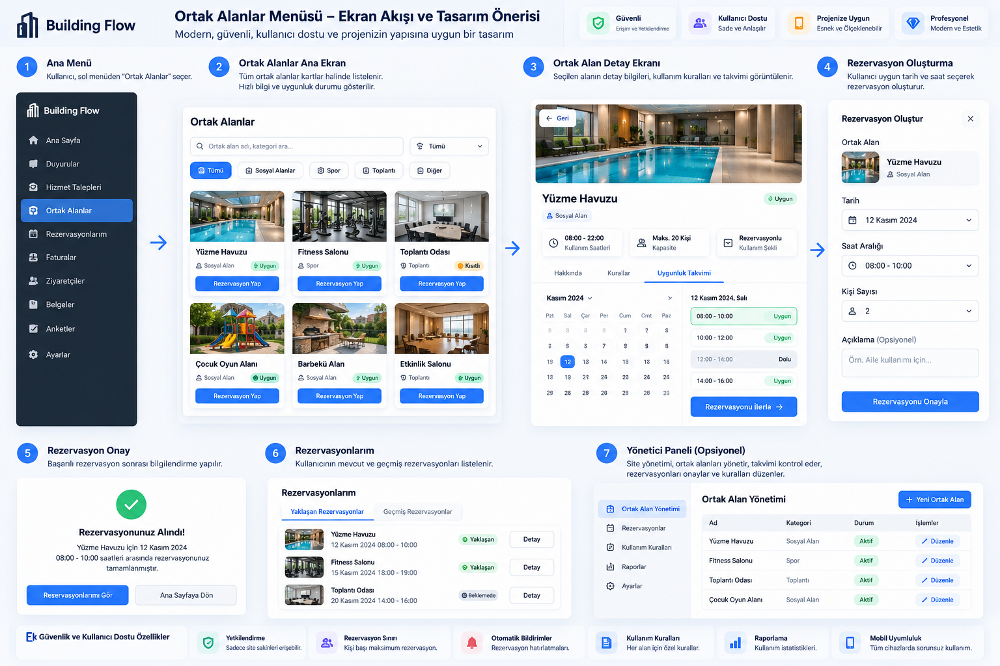

# FAZ 06 — Mobil ve offline akış

## Kullanıcı kararı — 26.10.2026: yönetici yazar, diğer kullanıcılar görüntüler

- Ortak alan tanımı ve rezervasyon oluşturma/düzenleme/iptal gibi yönetim işlemleri yalnız yetkili SUPER_ADMIN/SITE_ADMIN/MANAGER ve backend kapsam kontrolüyle yapılır.
- Yönetici dışındaki kullanıcılar web/merkez ve mobil ekranlarda yalnız yetkili oldukları ortak alanları ve rezervasyon saatlerini salt okunur görür. Rezervasyon oluşturma/değiştirme/iptal veya rezervasyon talebi gönderme yetkileri yoktur; ACCOUNTANT yönetici sayılmaz.
- Örnek: kapalı halı saha detayında tarih seçilince dolu/rezerve, boş ve bakım nedeniyle kapalı saat aralıkları gösterilir. Başka kullanıcıların ad/telefon/açıklama/ödeme bilgileri takvimde yayımlanmaz. Salt zaman ve kullanım durumu görünür.
- Okuma Property/tenant ve varsa blok görünürlüğünü izler; istemcide düğmeyi gizlemek yeterli değildir, yazma uçları backend'de de reddedilir. Web ve mobil aynı sunucu yetkisini/verisini kullanır.
- Offline görüntü son güncelleme zamanıyla eski önbellek olarak belirtilir; boş saat garantisi vermez. Yönetici kesin rezervasyon/iptal işlemi yalnız online sunucuda tamamlanır.
- Bu karar görseldeki yönetici dışı “Rezervasyon Yap/Onayla” akışının yerine geçer. FAZ02 şu an yalnız katalog sağlar; saat/rezervasyon motoru FAZ04, web görünümü FAZ03 ve ilgili entegrasyon, mobil FAZ06 kapsamındadır. Bu kayıt sonraki fazı başlatmaz.

## Hedef
Mobil ekranlar, çoklu yönetim alanı, kullanıcıya salt okunur alan/rezervasyon saatleri, güncellik bilgili offline önbellek; yalnız yöneticiye online yazma ve uygun taslak/senkron akışı.

## Referans görsel

## Codex / Claude Code talimatı
MASTER_PROMPT.md kurallarını uygula. Önce bu fazla ilişkili mevcut kodu, testleri, issue'yu ve bağımlılıkları incele. Yapılacak işleri küçük adımlara ayır; her adımı Türkçe konsola yaz. Mevcut bileşenleri yeniden kullan. Uygulamanın rol, tenant ve blok modeline uyum sağla. Gerçek kodu geliştir, migration ve dokümantasyonu tamamla. Sonraki faza geçme.

## Kontrol listesi
- [x] Mevcut kod ve etkilenen modüller analiz edildi
- [x] Tasarım ve güvenlik/rol etkisi doğrulandı
- [x] Gerekli kod, doküman ve testler tamamlandı
- [x] Mobil UI, offline/online ve senkron testleri
- [x] Lisans ve dolaylı bağımlılık kontrolü raporlandı
- [x] GitHub Issue ayrıntılı kanıtlarla güncellendi
- [ ] Kullanıcı kabulü alındı ve kapanış kriterleri sağlandı

## Faz sonu raporu
Değişen dosyalar, commit/PR, test komutları ve sonuçları, ekran görüntüleri, açık riskler, rollback, sonraki faz ön koşulları. Test geçmeden Issue kapatma.
