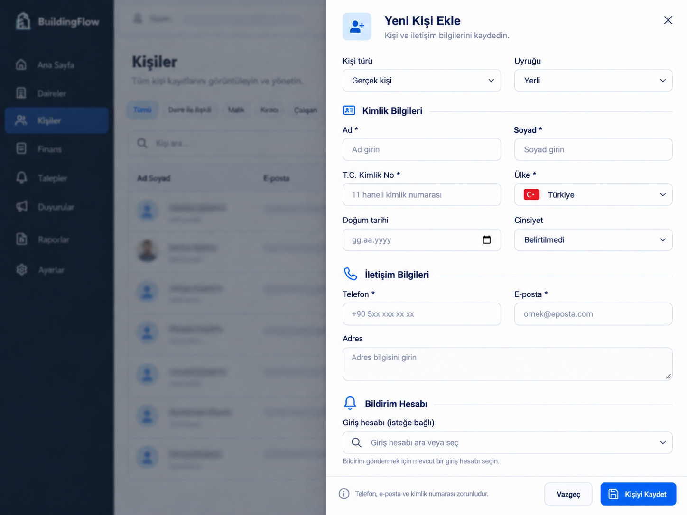

# Yeni kişi formu — görsel öneri

Kaynak: kullanıcının12.10.2026 ekran görüntüsü. Built-in image_gen, imagegen skill'i; CLI kullanılmadı. Ana tasarım: mevcut alanları koruyan, Kimlik Bilgileri/İletişim Bilgileri/Bildirim Hesabı grupları, iki sütunlu beyaz sağ drawer; BuildingFlow lacivert/mavi dili. Ülke adı+bayrak ve birleşik aranabilir hesap seçimi görsel öneridir; kodlanmadı.

Son düzeltme prompt'u (aynen):

Edit this UI mockup with one precise text correction only. In the 'Bildirim Hesabı' section, replace the field label 'Giriş hesabı *' with 'Giriş hesabı (isteğe bağlı)'. Remove its asterisk because linking a login account is optional for registering a person and only needed for sending a notification. Preserve every other pixel, layout, field, title, icon, background, colors, footer, spacing, proportions and text unchanged. Keep Turkish text crisp. Do not add any controls or alter any other required-field asterisks.

