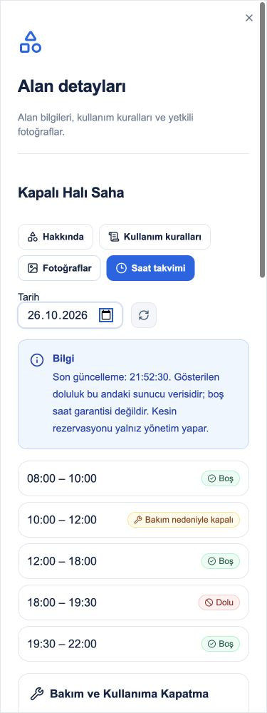
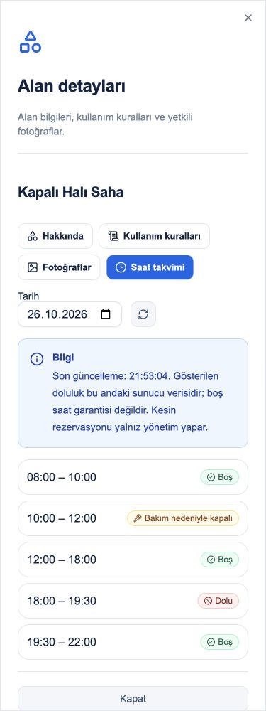

# Ortak Alanlar FAZ05 — teknik teslim, kullanıcı kabulü bekliyor

26.10.2026 · OA-05 · plan05/08 · [Issue #55](https://github.com/AkaBayraK/BuildingFlow/issues/55). Kaynak: [FAZ05](../../BuildingFlow-OrtakAlanlar/FAZ-05.md), [API](../api/common-areas.md).

## Sonuç ve önceki teslimin birleştirilmesi

**Mevcut bakım planı üzerinden ortak alan saat kapatma, rezervasyon blokajı, gerekçeli yeniden açma, duyuru ve mevcut kişisel bildirim kutusu bağlantısı uygulandı.** Yönetici yazar; sakinler web/merkez ve gelecekteki mobil tüketicide yalnız yetkili saat takvimini okur. FAZ06 başlatılmadı.

Kullanıcı FAZ03/04'ün yapıldığını bildirip FAZ05'i başlattı. İncelemede FAZ04'ün [Issue #54 tesliminde](https://github.com/AkaBayraK/BuildingFlow/issues/54#issuecomment-6422281598) belirtilen `.claude/worktrees/compassionate-leakey-2dd3e1` altında kaldığı, main çalışma dosyalarında bulunmadığı görüldü. Gerekli21 kaynak dosyası ve FAZ04 teslim raporu ve yeni hata/çeviri/DI ekleri main'e taşındı; önceki FAZ03 odak düzeltmeleri korundu. Kaynak worktree değiştirilmedi. Önceden staged71 dosyalık Git indeksinin binary diff SHA256 özeti başlangıçla aynı; add/commit/push/merge/reset yapılmadı. Bu iş, rezervasyon motorunu yeniden geliştirme değildir; tamamlanmış teslimin entegrasyonudur.

## Davranış ve güvenlik

- `CommonAreaClosure`: Property/alan/mevcut MaintenancePlan/duyuru composite FK; UUID+normalize fingerprint, version, sekiz NOT NULL audit alanı, soft-delete filtresi. Kapanış aralığı yerel Europe/Istanbul günü ve15dk saatleriyle tanımlanır. Plan günüyle eşleşir; en çok365gün ileri, bitmiş aralık açılmaz. Bu sürüm tek gün/aralık içindir; gece aşımı ve çok günlük kapanış tek kayıtta yoktur.
- Oluşturma ve rezervasyon aynı Property FOR UPDATE kilidinden geçer. Kapalı aralığa rezervasyon POST/PUT409; mevcut onaylı rezervasyonla çakışan kapanış409. Eski rezervasyon otomatik iptal edilmez; yarım duyuru/bildirim kaydı oluşmaz. Değen sınırlar çakışmaz.
- Aynı UUID ve aynı normalize içerik güncel kapanışı replay eder; farklı içerik/aktör409. Aktif aynı plan/alan bağlantısı ve örtüşen kapanış engellenir. Plan ve alan version'ları artırılır.
- Bakım PLANNED/IN_PROGRESS iken bağlı gün değiştirilemez. COMPLETED/CANCELLED veya soft-delete, aynı transaction'da yalnız ilgili kapanışları kaldırır; eski duyuru arşivlenir, yeni açılma duyurusu oluşturulur. Elle kaldırma version+gerekçe ister, ikinci kaldırma409. Plan yeniden aktifleşince sessiz otomatik kapanış oluşturulmaz.
- Takvim `CLOSED` aralığı döndürür (reserved0); rezervasyon doluluğu sayılmaz. Sakin DTO'suna bakım planı/duyuru/not/kişi/daire eklenmedi. Yazma yalnız SUPER_ADMIN/SITE_ADMIN/MANAGER; diğer roller403, yabancı scope/kaynak404. Mevcut daire bağlamı ve tenant/issuer-subject/hesap ilişkisi korunur.
- Duyurular mevcut Announcement üzerinden MAINTENANCE kategorisinde yayımlanır. PROPERTY görünürlüğünde ALL_MEMBERS; BUILDING görünürlüğünde MANAGEMENT seçilir, Property genelinden blok bilgisinin sızması engellenir. Blok sakinleri kapalı saati yalnız kendi yetkili takviminden görür.
- Kişisel bildirim, mevcut `person_messages` kutusuna yalnız aktif PropertyMembership'i olan, bağlı legacy Person alıcıları için yazılır; hesap başına tek kayıt. Blokla sınırlı kapanışta bu geniş kapsamlı kanala gönderilmez. NotificationCount **yazılan kayıt** sayısıdır; cihaz teslimi/okundu garantisi değildir. Canonical kişi için legacy bağ yoksa kişisel kutu kaydı üretilmez; yetkili duyuru/takvim vardır. Yeni genel bildirim platformu veya sahte Person oluşturulmadı. Gerçek SMS/e-posta/push/broker teslimi yapılmadı.
- Kamuya gösterilecek notice, yönetici tarafından açıkça girilir; bakımın iç açıklaması ve rezervasyon notları kopyalanmaz. Sistem duyuru başlıkları mevcut Türkçe içerik üretimiyle saklanır; TR/EN arayüz ve hata sözlüğü eşlidir.

## Değişen ana dosyalar

Domain `CommonAreaClosure.cs`; Application `CommonAreaClosures.cs`; Infrastructure `CommonAreaClosureConfiguration.cs`, `CommonAreaClosures.cs`, `CommonAreaReservationStore.cs`, `CommonAreaStore.cs`, `MaintenanceStore.cs`; API endpoints, DI ve ErrorCatalog. Web `CommonAreaMaintenance.tsx`, schedule/panel/model/style, TR/EN ve error registry. Mevcut roadmap'e OA-05 doğrulanmış görevi bağlandı; diğer fazlar tiklenmedi. Testler `CommonAreaMaintenanceTests.cs`, `CommonAreaMaintenanceMigrationTests.cs` ve mevcut common-areas web testidir.

Migration **20261026174038_CommonAreaMaintenanceClosures** yalnız yeni tablo/index/FK/check ekler, Designer+snapshot içerir. Eski migrationlar değiştirilmedi. Down herhangi kapanış geçmişinde (soft-delete dahil) ilk drop öncesi durur. Canlı DB'ye uygulanmadı; AutoMigrate açık sonraki API başlangıcı pendingmigration'ları uygulayabilir. Boş Down/Up mümkündür; dolu ortamda ileri düzeltme/izole restore gerekir.

## Bu tur gerçek doğrulama

| Komut / kapsam | Sonuç |
|---|---|
| `dotnet build backend/BuildingFlow.sln --no-restore -m:1 --disable-build-servers` | **GEÇTİ,0hata/0uyarı** |
| Ayrı PG'de CommonArea/Persistence/MigrationTests/Authentication/Maintenance/Hierarchy/PropertyTypeChange/ErrorContract/SchemaContract/BaseEntity filtresi | **164/164 integration +10/10 unit,0atlanan** |
| Web `npm test` | **274/274,0atlanan** |
| Web `npm run typecheck` ve varsayılan `npm run build` | **GEÇTİ**; FAZ04 worktree symlink ortamı yerine main'de gerçek Turbopack build |
| `python3 scripts/check-licenses.py` | **GEÇTİ,329 npm/NuGet sürümü**, manifest/lock/env/lisans envanteri değişmedi |
| Belge bağlantıları, kaynak/indeks koruma, `git diff --check` | Teslim kontrolünde doğrulandı |

Son backend TRX: `/tmp/bf-common05-results/common-area05_net10.0_20261026215948.trx` ve `...215949.trx`. Logs: `/tmp/bf-common05-{build,tests,web-tests,typecheck,web-build,licenses}.log`. Bunlar yerel koşulardır; CI URL/commit/PR yok.164 toplamına yeni testler tekrar eklenmez. Önceki FAZ03/04 test sonuçları bu turun yerine kullanılmadı.

PG senaryoları: kapat/replay/farklı içerik; rezervasyon blokajı ve bitişe değen rezervasyon; elle açma/ikinci açma409; plan tamamlandı/iptal/silme ile otomatik açma; rezervasyonun izinsiz iptal edilmemesi ve rollback; plan tarih koruması; rol/foreign plan/bozuk saat/metin; kapanış–rezervasyon yarışı tek kazanan; blok duyurusunun geniş kanala çıkmaması; gerçek canonical daire bağlamından CLOSED ve yönetim bilgisinin yokluğu. Migration upgrade/repeat/boşDown/reUp/eski satır audit JSON eşliği, FK/check, dolu geçmişte Down reddi, snapshot ve bütün uygulama tablolarının8NOTNULL taraması geçti.

İlk iki koşuda yeni bildirim fixture'ının legacy kişi profil/iletişim alanları eksikti;7 senaryo DB kısıtında durdu. Üretim koruması gevşetilmedi; fixture düzeltildi, son164/164 geçti. İlk UI saat-fill denemesi boş native time değeri bıraktı ve validasyon doğru reddetti; gerçek klavye girişiyle10:00–12:00 oluşturma doğrulandı. Hata sonrası form/plan korunur;409 hata bildiriminin yenilemede kaybolmaması düzeltildi.

## UI kabulü ve açık sınırlar

Gerçek React bileşenleriyle açıkça işaretli loopback fixture; gerçek API/auth değildir. Yönetici plan seçip10:00–12:00 kapattı, takvim CLOSED oldu; gerekçeyle kaldırınca serbest aralık geri geldi. Aynı fixture verisiyle sakin görünümüne geçildi: CLOSED var; oluştur/kaldır/iptal düğmesi ve özel yönetim notu yok.375px yatay taşma0. Backend bağlam doğrulaması ayrı gerçek PG/API testidir; fixture bunu taklit ederek kanıt sayılmadı.

Gerçek Keycloak/API/depo ile browser E2E, native mobil test, SMS/e-posta/push teslimi ve yük/pentest çalıştırılmadı. Yeni paket/font/ikon/görsel/imaj yok; mevcut Lucide kullanıldı, ekran görüntüleri yerel test kanıtıdır.329 metadata kontrolü container SBOM/copyleft veya ticari uygunluk sertifikası değildir.

## Teslim kapısı

Çalışma adımı3/3=%100,00 teknik teslim; resmi faz6/7=%85,71 kullanıcı kabulü bekliyor. Kullanıcı önceki dört fazı tamamlanmış bildirerek FAZ05'i başlattı: kabul edilen akış4/8=%50,00; FAZ05 onaysız tamamlanmış faz sayılmadı. Mevcut ürün yol haritası26kayıt,143/153=%93,46. Issue #55 açık kalır; #54/#53 kapanmadı. FAZ06 başlatılmadı. Git indeksi ve kaynak worktree korundu; commit/push/deploy yok. Yalnız test kaynakları temizlenir; canlı ayar/veri/servis değiştirilmez.

Son şema kontrolünde nullable release_reason için SQL CHECK üç değerli mantık koruması sıkılaştırıldı; eksik gerekçeyle kaldırma güncellemesi negatif DB testinde reddedildi. Yeni migration/Designer/snapshot birlikte güncellendi, son164/164+10/10 koşusu bu sürümdendir.

Giriş token: BİLGİ MEVCUT DEĞİL. Çıkış token: BİLGİ MEVCUT DEĞİL. Toplam token: BİLGİ MEVCUT DEĞİL. Kalan context: BİLGİ MEVCUT DEĞİL. Son kaynak Codex usage/rateLimitsByLimitId.codex, 26.10.2026:300dk kullanılan%73/kalan%27, reset27.10.2026 01:34:15;10080dk kullanılan%27/kalan%73, reset02.11.2026 15:28:41 Europe/Istanbul. Hesap kotası sohbetin token tüketimi değildir.
