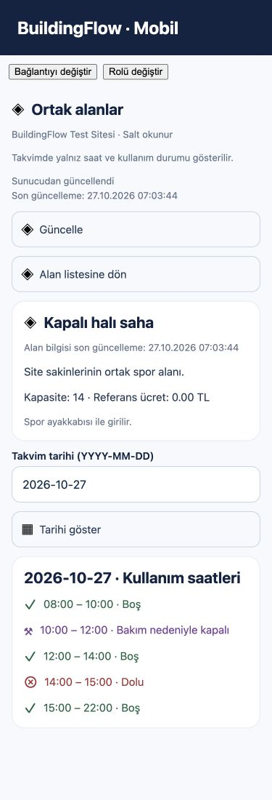
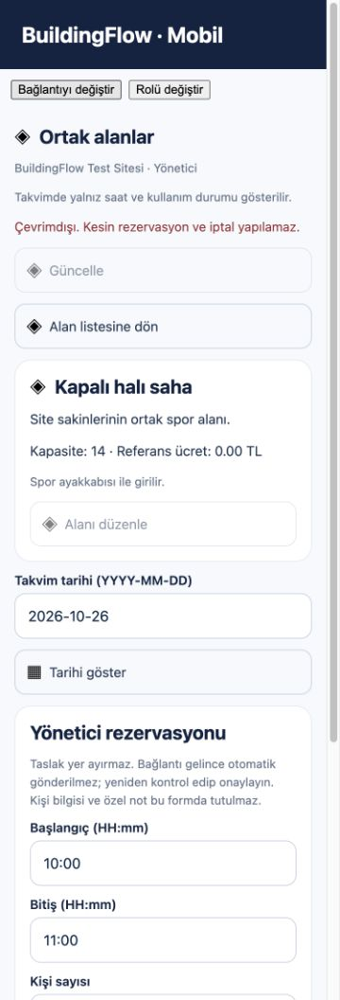

# OA-06 — Mobil ve offline akış — teknik teslim

27.10.2026 · Issue #56 · Ortak Alanlar planı **06/08**. Yalnız bu faz uygulandı. Kullanıcı kabulü bekliyor; Issue açık, FAZ07 başlatılmadı. Commit/PR/push/deploy yapılmadı; önceki staged/unstaged çalışmalar korundu.

## Uygulanan davranış

- Mevcut portföy/çalışma alanı seçimi kullanılır. Canonical mobil ana ekrana ortak alan modülü, eski tab düzenine Expo Router ekranı eklendi. Yönetici rolü SUPER_ADMIN/SITE_ADMIN/MANAGER; ACCOUNTANT tek başına yönetici değildir. Diğer kullanıcılar doğrulanmış OWNER/TENANT/RESIDENT daire ilişkisiyle salt okunur liste/detay/saat takvimi görür. Hesap veya bağlam değişince feature yeniden kurulur; eski asenkron yanıtlar uygulanmaz.
- İkonlu alan türleri, kapasite, açıklama/kurallar, referans ücret ve saatler; günlük FREE/PARTIAL/FULL/CLOSED aralıkları. Tarihler Europe/Istanbul, aralık15dakika. Kullanıcıya rezervasyon/talep/iptal düğmesi verilmez. Özel not, kişi/daire kimliği takvimde yayımlanmaz.
- Yönetici online alan oluşturur/düzenler/etkinlik değiştirir; mevcut blok ataması korunur, yeni alan Property genelinde oluşturulur. Blok atama ve fotoğraf yönetimi merkez ekranında kalır. Alan silme, rezervasyon düzenleme, gelişmiş yönetici takvimi/rapor/ödeme bu mobil teslimde yoktur; sonraki faz başlatılmadı.
- Yönetici online rezervasyon oluşturur veya version+gerekçeyle iptal eder. UUID aynı form/retry boyunca korunur; çakışma409 başarı sayılmaz. Gönderim kilidi ve hesap/bağlam yaşam döngüsü kontrol edilir; ham sunucu exception/message gösterilmez. Belirsiz sonuç kesinleşmiş sayılmaz.
- Native cihazda mevcut SQLCipher/SecureStore deposundaki `owner_snapshots` kullanılır; yeni tablo/migration yok. Hesap+doğrulanmış context başına en son liste ve en son alan/tarih takvimi olmak üzere iki sınırlı slot,24saat üst sınır/geri saat reddi vardır. Hesabın mevcut offline yetki süresi/biyometri kapısı ayrıca korunur. Son güncelleme görünür; eski kopya boş saat garantisi vermez. Web kalıcı offline kopya saklamaz.
- Yönetici taslağı üçüncü sınırlı slotta, kişi/daire/not içermeden saklanır; yer ayırmaz, otomatik outbox/senkron gönderimi yoktur. Native online gönderimden önce taslak UUID ile saklanır; yeniden açarken aynı alan/tarih gerekir, kullanıcı online onaylar. Refresh/online dönüş/app-focus okuma verisini tekrar doğrular; offline kesin işlem engellenir. Logout/hesap temizliği mevcut şifreleme anahtarı/veritabanı temizliğini kullanır.

## Mimari ve güvenlik

Framework bağımsız mevcut web sözleşmesi `shared/common-areas.ts` altına taşındı; webdeki eski import yolu re-export ile korundu. Mobil ve web aynı DTO/rezervasyon doğrulamasını kullanır; backend endpoint/rol/üyelik/blok/kapasite/transaction sözleşmeleri değiştirilmedi. Native istek portu seçili context üzerinden URL'yi tekrar kurup tam eşleştirir; yabancı Property/daire/ilişki/query ve yönetici dışı yazım reddedilir. Sunucu yetki otoritesidir; UI kontrolü yetki yerine geçmez.

Takvimde beklenmeyen üst/interval alanları ve kişisel alanlar reddedilir.401 oturumu temizler;403/404 ilgili kopya ve taslağı temizleyip görünümü kapatır. Yerel purge başarısız olsa bile erişim reddi korunacak şekilde ortak `loadScoped` düzeltildi ve regresyon testi eklendi. Yeni token deposu, localStorage, auth bypass, log/telemetri/kişisel veri yüklemesi yok. Önceki native SQLCipher/biyometri güvenliği gerçek cihazda bu tur yeniden doğrulanmadı; offline cihaz sunucudaki iptali anında bilemez. Geçerli süre sınırı ve online yeniden doğrulama bu sınırı ortadan kaldırmaz.

## Bu tur doğrulama

| Komut/kabul | Sonuç |
|---|---|
| Mobil `npm run check` | **TypeScript + lint +152/152 test GEÇTİ**,0atlanan |
| Mobil `npm run build` | **Expo iOS/Android/web export GEÇTİ**; imzalı native binary değildir |
| Mobil `npm run release:licenses` | **871 mevcut lockfile paket kaydı metadata GEÇTİ** |
| Web `npm test` | **274/274 GEÇTİ**,0atlanan |
| Web `npm run typecheck`, `npm run build` | **GEÇTİ**, varsayılan üretim derlemesi |
| İzole React Native Web UI fixture |375px salt okunur listeden detaya geçiş, CLOSED/FREE/FULL, yazma düğmesi0; yönetici409 hata, offline kesin işlem engeli;375/430px yatay taşma yok |
| Git kontrolü | `git diff --check`; mevcut indeksin hash karşılaştırması; manifest/lock değişikliği yok |

Yeni beş feature testi: seçili yönetici/daire URL ve rol izolasyonu, salt okunur takvim gizliliği/aralıklar, hesap/rol/tarih/24saat/geri saat cache sınırı, sınırlı slot ve bozuk payload, taslak UUID/not temizleme/yetki/expiry. Ek ortak loader testi: purge hatasında erişim reddi kaybolmaz. Önceki146 test yeni çalıştırmaya dahildir, geçmiş sonuç kopyalanmadı.

İlk typecheck/check çağrıları yanlış çalışma dizini nedeniyle paket bulamadı; bu çağrılar test geçişi değildir. Geliştirme sırasında JSX sözdizimi, lint effect kuralı, fixture ReactDOM tipi ve bozuk cache test beklentisi düzeltildi. Son komutların gerçek logları `/tmp/bf-common06-{check,export,web-tests,web-types,web-build,licenses,ui}.log`; CI çalıştırılmadı/CI URL yok.

Fixture yalnız test dosyalarında auth/API/shell ikon portlarını değiştirir; gerçek React Native Web feature bileşenlerini çalıştırır. Ekran görüntüsü canlı kullanıcı/API, gerçek native ikon fontu veya cihaz SQLCipher kanıtı değildir. Native fiziksel cihaz/simülatör, biyometri, şifreli SQLite runtime, canlı Keycloak/API E2E, backend/.NET/PostgreSQL testleri, MinIO galeri, push/SMS, yük/pentest ve container smoke bu tur çalıştırılmadı. Backend/DB değişmediğinden yeni migration testi gerekmiyor; eski fazın PG sonucu yeni test gibi gösterilmedi.

## Dosyalar ve lisans

- `mobile/buildingflow-mobile/src/common-areas/`: contracts, cache/draft, hook, native görünüm/form ve tek ikon eşlemeleri.
- `mobile/buildingflow-mobile/src/auth/AuthProvider.tsx`: dar kapsamlı istek/cache portları; `src/data/scopedRead.ts`: reddi koruma.
- `mobile/buildingflow-mobile/src/person-authorization/PersonModelScreen.tsx`, `src/app/(tabs)/{_layout,common-areas}.tsx`: mevcut akışa bağlantı.
- `shared/common-areas.ts`, web `src/features/common-areas/model.ts`: ortak saf sözleşme.
- Mobil testler, izole fixture ve script; `docs/TESTING.md`, API/ilerleme/lisans kayıtları; mevcut roadmap ve TR/EN kanıtları.

Yeni üçüncü taraf paket/kütüphane/font/ikon/görsel/container yok; manifest/lock ve mevcut LICENSE/NOTICE korundu. Native ikonlar zaten kurulu Ionicons setinden; lucide native veya tarih/önbellek paketi eklenmedi. SQLite/UUID mevcut Expo SDK, formlar mevcut React Native/Action/FormField ile; şifreleme mevcut yapılandırma. Yeni dağıtım lisansı veya SBOM sertifikasyonu iddiası yok.871 metadata kontrolü mevcut ticari/container/copy-left/NOTICE yükümlülüklerinin yerine geçmez; önceki lisans riskleri devam eder. Merkezi329 envanteri bu tur yeniden üretilmedi.

## Kalan kabul, geri alma ve ilerleme

Kullanıcı kabulü, canlı hesap/çoklu Property-blok/daire ve gerçek cihaz offline-biyometri/yeniden bağlantı kabulü açık. Fotoğraf galerisi/yükleme bu mobil faza eklenmedi. Taslak sunucu rezervasyonu değildir; geçmiş önbellek anlık uygunluk değildir. Ücret referanstır, tahsilat yapılmaz.

Geri alma: yalnız OA-06 feature/bağlantı ve ortak sözleşme taşımasını inceleyerek geri alın; web re-export yerine taşıma öncesi aynı sözleşmeyi geri koyun. Önceki faz dosyaları, `.env`, canlı veri ve Git indeksi silinmez/resetlenmez. Backend migration yok; cihaz snapshot slotları türetilmiş cache olduğundan mevcut logout temizliği yeterli. Kör `git reset --hard` kullanılmaz.

Tur **3/3=%100,00** teknik teslim; resmi faz **6/7=%85,71** (kullanıcı kabulü açık). Önceki fazlar için devam onayı5/8=%62,50; OA06 kullanıcı kabulü sayılmadı. Ürün roadmap **27kayıt,144/154=%93,51**; OA06 yalnız uygulanmış kod/yerel doğrulama olarak işaretlendi, native kabul açıkça yazıldı. Mobil ana15faz ve UI faz sayaçları değiştirilmedi. Ortak Alanlar paketinde ayrı PHASES.md yok; sekiz faz MASTER_PROMPT.md içindeki plandan alınır; UI PHASES.md ayrı kaynaktır.

Giriş token: BİLGİ MEVCUT DEĞİL. Çıkış token: BİLGİ MEVCUT DEĞİL. Toplam token: BİLGİ MEVCUT DEĞİL. Kalan context kapasitesi: BİLGİ MEVCUT DEĞİL. Codex usage/rateLimitsByLimitId.codex son okuma27.10.2026:300dk kullanılan%13/kalan%87, reset 27.10.2026 12:00:53;10080dk kullanılan%33/kalan%67, reset02.11.2026 15:28:41 Europe/Istanbul. Hesap kotası bu sohbetin token tüketimi değildir.

Tek agent; akadev-phase/contract/security/license/verify/docs prosedürleri uygulandı. Yeni skill/agent/MCP kurulmadı. Sonraki adım kullanıcı kabulü; FAZ07 için ayrıca kullanıcı talimatı beklenir.

## Görsel kanıt

GitHub teslim yorumu: https://github.com/AkaBayraK/BuildingFlow/issues/56#issuecomment-6433481231 — Issue güncelleme yanıtında `state=open`, yorum1 ve kullanıcı kabulü boş doğrulandı.

Bu tur açılan13009fixture ve test sekmesi kapatıldı; kullanıcının önceden açık servislerine dokunulmadı.
