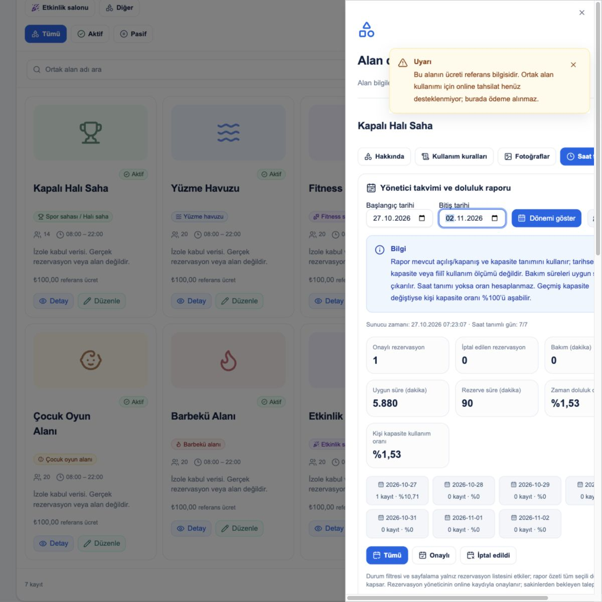
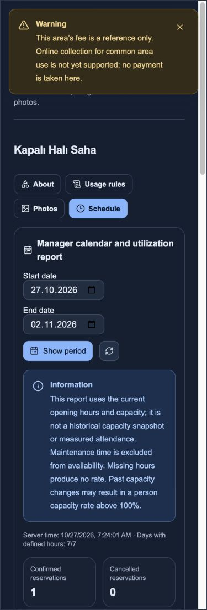
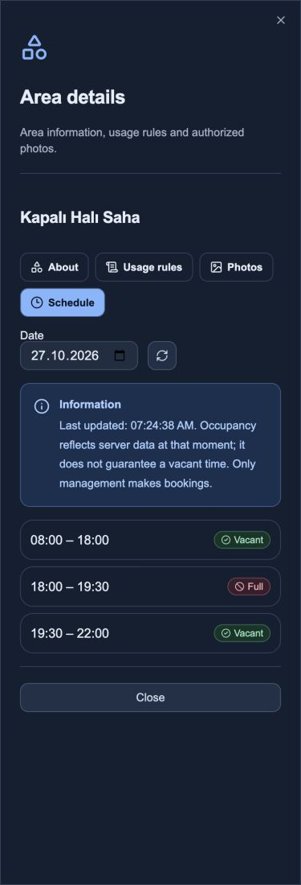

# OA-07 — Yönetici takvimi ve raporlar

27.10.2026 · Issue #57 · Ortak Alanlar planı **07/08**. Yalnız FAZ07 uygulandı. Teknik teslim hazır; kullanıcı kabulü açık, Issue kapatılmadı, FAZ08 başlatılmadı. Commit/PR/push/deploy yok; önceki staged/unstaged çalışmalar ve Git indeksi korundu.

## Uygulama ve mimari kararlar

- Alan detayındaki saat takvimine yönetici dönem görünümü eklendi: başlangıç/bitiş, günlük doluluk kartları, ikonlu durum filtreleri, sayfalı rezervasyon listesi ve gün seçimi. Mevcut shadcn kaynakları/TanStack `RecordList`, bildirimler, TR/EN ve Lucide kullanıldı; yeni takvim/rapor paketi yok.
- Yönetici rezervasyonu düzenler, tarihi/saatleri/kişi sayısını/notunu mevcut PUT sözleşmesiyle kaydeder veya version+gerekçeyle iptal eder. Düzenlemede mevcut RequestId, UnitId ve beklenen version korunur. Eski sürüm409 tekrar yazılmaz; kayıt yeniden yüklenir. Gönderim kilidi, form odağı ve ortak güvenli hata bildirimi kullanılır. İptal kaydı geçmişte kalır; ayrı immutable düzenleme-revision tablosu eklenmedi.
- Onay, yöneticinin online oluşturma/kaydetme eylemidir. Sakin rezervasyon talebi veya PENDING akışı yoktur; yeni bir onay durumu uydurulmadı. SUPER_ADMIN/SITE_ADMIN/MANAGER + backend aktif kapsam kontrolü korunur. ACCOUNTANT dahil diğer kullanıcılar yönetim raporunu/yazma işlemlerini alamaz; kendi yetkili alan/saat görünümü salt okunurdur.
- Rapor yeni `GET /api/v1/properties/{propertyId}/common-areas/{areaId}/report?from=YYYY-MM-DD&to=YYYY-MM-DD` ucundan gelir. Tarihler iki uç dahil,2000–2100 ve en fazla93gün. Geçersiz aralık mevcut kodlu400; anonim401, yönetici dışı403, yabancı/erişilemeyen alan404. Yeni hata kodu/politika yok.
- Rapor `RepeatableRead` transaction içinde Property/üyelik/tenant kontrolü, alan ve rezervasyon/bakım verisini okur. Liste sayfası/durum filtresi özeti değiştirmez. DB gruplaması özel not/kişi/daire alanlarını seçmez;100000 interval grubu üstünde kısmi sonuç yerine400 ile daha dar tarih gerekir. Yeni entity/tablo/index/migration yok; modular monolith ve mevcut kalıcı veri sözleşmesi korunur.

## Doluluk tanımı ve sınırlar

Yanıtta scope/tarih/asOf/areaVersion, mevcut kapasite/saatler, `currentConfiguration=true`, `paymentSupported=false`, ölçülebilen gün sayısı, günlük metrikler ve dönem toplamı vardır.

- Onaylı/iptal kayıt sayıları ayrı; iptal edilenler süre/kişi kullanımına katılmaz.
- Açılış süresi mevcut açılış/kapanış tanımından gelir. Aktif ve kaldırılmamış bakım aralıklarının birleşimi bu pencereye kırpılır. Uygun dakika = açılış − bakım.
- Rezerve dakika onaylı aralıkların birleşimidir; çakışan rezervasyon aynı dakikayı iki kez saymaz. Bakım aralığı kullanım pay ve paydalarından çıkarılır.
- Kişi-dakika eşzamanlı kişi sayısının süre toplamıdır. Zaman doluluk = rezerve/uygun; kişi kapasite kullanımı = kişi-dakika/(uygun dakika×mevcut kapasite). Dönem yüzdeleri günlük yüzdelerin ortalaması değildir; toplam dakikalardan hesaplanır. İki ondalık, yarım değerde sıfırdan uzağa yuvarlama; istemci BigInt kontrolüyle eşleşir.
- Saat tanımsızsa süre/oranlar null; payda sıfırsa oran null ve UI `—` gösterir. Sıfır rezervasyon, bilinen pozitif paydada gerçek%0'dır.
- Saat/kapasite geçmişi tutulmadığından bu **mevcut tanıma göre rezervasyon raporudur**; tarihsel kapasite, fiilî giriş/kullanım ölçümü, geçmiş açılma/pasiflik takvimi veya finans bilançosu değildir. Geçmiş kapasite düşürüldüyse kişi oranı%100'ü aşabilir; gizlenmez/kırpılmaz. Bu sınır ekranda belirtilir.

## Ücretli kullanım / mevcut ödeme incelemesi

`OnlinePayments.cs` CreateIntentRequest/IntentLineResponse gerçek borç `ChargeId` sözleşmesini kullanır. Rezervasyon ile ücret/borç bağlantısı ve ücret snapshot'ı yoktur. Ayrıca `PaymentProviders.cs` gerçek IYZICO/PAYTR/BANK_POS sağlayıcılarını **Planned** olarak listeler; `DependencyInjection.cs` içinde yalnız SandboxPaymentProvider adapter'ı kayıtlıdır. Sandbox gerçek tahsilat değildir.

Bu nedenle koşullu mevcut ödeme entegrasyonu ortak alan için kullanıma hazır değildir. Yeni finans modeli, otomatik borç, ödeme sağlayıcısı veya sahte başarılı tahsilat eklenmedi. Ücret referans olarak kalır; rapor gelir/tahsilat tutarı üretmez, ödeme butonu/checkout yoktur. `paymentSupported=false` ve istemcide bunun dışındaki yanıtın reddi test edildi. Gerçek sağlayıcı/tahsilat/iade testi **çalıştırılmadı**; başarılı sayılmadı. Ücretli kullanım istenirse rezervasyon-ücret borcu/snapshot/iptal-iade sözleşmesi ve gerçek sağlayıcı ayrıca onaylanmalıdır; bu tur yeni ürün fazı açılmadı.

## Bu tur test ve kanıtlar

| Komut / kapsam | Gerçek sonuç |
|---|---|
| `dotnet build backend/BuildingFlow.sln --no-restore -m:1 --disable-build-servers --verbosity quiet` | GEÇTİ |
| İzole DB ile `dotnet test backend/BuildingFlow.sln --no-restore -m:1 --disable-build-servers --filter FullyQualifiedName~CommonArea` | **42/42 PostgreSQL/API +13/13unit GEÇTİ**,0atlanan |
| Web `npm test` | **280/280 GEÇTİ**,0atlanan |
| Web `npm run typecheck`, `npm run build` | **GEÇTİ**, varsayılan üretim build |
| İzole gerçek React UI / test API portu | Yönetici düzenleme90→60dk ve iptal sonrası0dk/iptal geçmişi;375px TR/EN koyu,1200px TR rapor; readonly aktif rezervasyonda özel not/rapor/yazma yok; yatay taşma0 |
| Kaynak/bağımlılık koruması | `git diff --check` GEÇTİ; Git indeksi hash aynı; package/lock/csproj/LICENSE/NOTICE farkı yok |

Yeni kapsam:9API senaryosu (üç yönetici rolü, dört yönetici dışı rol, saatsiz durum, yabancı/anonim/tarih sınırları);3unit testi (union/bakım, null/sıfır payda, kırpma/toplam/yuvarlama/geçmiş kapasite);6web testi (scope/rapor sözleşmesi, dakika/toplam, null ve%100üstü, tarih, sayfa/durum, tam sayı yuvarlama). Mevcut ortak alan regresyonları bu tur yeniden çalıştırıldı. Rapor/listenin farklı filtre kapsamı; bakım kaldırıldığında toplam uygun sürenin geri gelmesi; yönetici notu/daire/ücret alanlarının rapora çıkmaması doğrulandı.

Son TRX: `/tmp/bf-common07-results/common-area07-final_net10.0_20261027072305.trx` (API), `...20261027072306.trx` (unit). Loglar `/tmp/bf-common07-{tests,web-tests,web-types,web-build,ui,build}.log`. CI çalıştırılmadı/CI URL yok. Geliştirmede JSX kapanış, ES hedefinde BigInt literal kullanımı ve test fixture kaldırma isteği parametre sırası hataları düzeltildi; ilk başarısız koşular geçiş kanıtı değildir.

UI fixture auth/API yerine yalnız test portları kullanır; canlı Keycloak/API E2E değildir. Gerçek native/mobil, tam backend suite, gerçek ödeme, yük/pentest, Docker smoke, release ve CI bu tur çalıştırılmadı. Mobil kaynak ve kullandığı mevcut ortak sözleşme değiştirilmedi; FAZ06 mobil152testi bu turun testi olarak sayılmadı. Yeni schema olmadığından migration/upgrade/Down testi eklenmedi; izole PG fixture mevcut migration'ları uyguladı. Canlı DB/migration/.env değiştirilmedi.

## Güvenlik, lisans ve dosyalar

Rapor ve yazma backend rol+aktif kapsam üzerinden doğrulanır; frontend düğme gizleme yetki sayılmaz. Report DTO'su özel not/kişi/daire/ödeme kimliği taşımaz; ölçü etiketlerine kişisel veri veya hamquery eklenmedi. Sakin için yönetim report endpoint'i yok. Yeni token/parola deposu, localStorage, anonim SSR verisi, auth bypass veya kişisel veri logu yok. Doğrulanmış yeni kritik/yüksek bulgu tespit edilmedi; bu ifade pentest/üretim güvenlik sertifikası değildir. Mevcut offline ve önceki faz kabul sınırları sürer.

Yeni üçüncü taraf paket/font/ikon/görsel/container yok; .NET BCL/EF, mevcut React/Next/shadcn/TanStack/Lucide ve projeye ait algoritma kullanılır. Takvim/sweep/yüzde için dış lisans ihtiyacı mevcut araçlarla karşılandı. Manifest/lock/csproj ve LICENSE/NOTICE farkı yok; install/restore yapılmadı. Merkezi/mobil lisans metadata taraması ve envanteri bu tur yeniden üretilmedi; önceki kontrol yeni çalıştırılmış sayılmadı. Ticari/container/copyleft/dağıtım yükümlülükleri ayrıca mevcut `docs/licenses.md` kapsamındadır.

Başlıca dosyalar:
- Backend Application/Infrastructure `CommonAreaReports.cs`; Application `CommonAreaReservations.cs` interface/partial service ve API `CommonAreaEndpoints.cs` report route.
- Unit ve Integration `CommonAreaReportTests.cs`.
- `shared/common-area-reports.ts`: saf tarih/rapor/sayfalama sözleşmesi; mevcut mobil sözleşmesi aynı.
- Web `CommonAreaManagerCalendar.tsx`, `CommonAreaSchedule.tsx`, `type-style.ts`, TR/EN ve `common-area-reports.test.mjs`; mevcut izole fixture genişletildi.
- API/TESTING/progress/licenses kayıtları, bu rapor, FAZ07 kontrol listesi ve mevcut ürün roadmapOA07 kanıtı.

Geri alma: yalnız OA07 report route/interface/partial kaynakları ve yeni yönetici bileşeni/bağlantısını inceleyerek geri alın. Önceki OA01–06 dosyaları ve kullanıcının Git indeksi korunur; kör reset/checkout kullanılmaz. DB şeması ve finans kaydı oluşmadı; rezervasyon işlemleri mevcut version/iptal geçmişi sözleşmesindedir, gerçek kayıtları topluca silmeyin.

Tur **3/3=%100,00** teknik teslim; resmi faz **6/7=%85,71** kullanıcı kabulü açık. Önceki fazlara devam onayı6/8=%75,00; OA07 kabulü sayılmadı. Ürün roadmap **28kayıt,145/155=%93,55**. Mobil15/UI/ilkTEKNİK sayaçları değiştirilmedi; ortak alan8faz MASTER_PROMPT.md kaynaklı, pakette ayrı PHASES.md yok. Tek agent; mevcut akadev-phase/contract/security/license/verify/docs kullanıldı, yeni agent/skill/MCP kurulmadı.

Giriş token: BİLGİ MEVCUT DEĞİL. Çıkış token: BİLGİ MEVCUT DEĞİL. Toplam token: BİLGİ MEVCUT DEĞİL. Kalan context: BİLGİ MEVCUT DEĞİL. Codex usage/rateLimitsByLimitId.codex27.10.2026:300dk kullanılan%65/kalan%35 reset27.10.2026 12:00:53;10080dk kullanılan%42/kalan%58 reset02.11.2026 15:28:41 Europe/Istanbul. Hesap kotası sohbet tüketimi değildir.

Sonraki adım kullanıcı kabulü; FAZ08 için yeni kullanıcı talimatı beklenir. Canlı E2E/üretim ödeme hazır varsayılmaz.

## Ekran kanıtları — izole fixture

Doğrulama sonrası yalnız OA07 için oluşturulan izole test veritabanı/rolü ve özel bağlantı dosyası temizlendi. Önceden açık servis/veri değiştirilmedi.

Bu tur açılan13010fixture sunucusu ve kabul sekmesi kapatıldı; önceki13006servisine dokunulmadı.

GitHub raporu: https://github.com/AkaBayraK/BuildingFlow/issues/57#issuecomment-6433754163 — güncelleme yanıtında Issue açık, kullanıcı kabulü boş doğrulandı.
