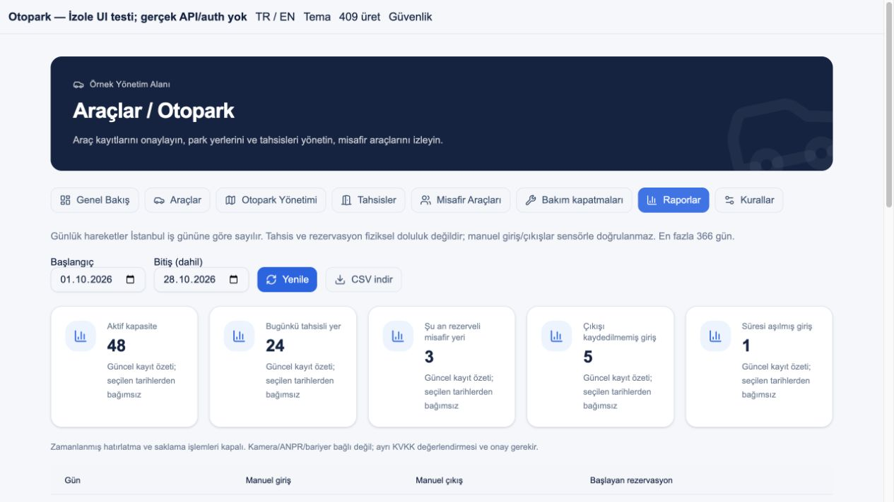

# OTOPARK FAZ07 — Entegrasyon, bildirim ve raporlar

28.10.2026 • Plan07/08 • [Issue79](https://github.com/AkaBayraK/BuildingFlow/issues/79) • [Teslim yorumu](https://github.com/AkaBayraK/BuildingFlow/issues/79#issuecomment-6461686087) • Teknik teslim; kullanıcı kabulü bekleniyor.

## Kapsam ve kaynak

Kullanıcı Faz07 talimatıyla Faz06 teknik teslimini kabul etti; #78 completed kapatıldı. İlk çalışma27.10.2026, son doğrulama28.10.2026. Kaynak `BuildingFlow-Araclar-Otopark/MASTER_PROMPT.md`, `FAZ-07.md` ve sekiz FAZ dosyası ana checkout'tadır; pakette PHASES.md yoktur. UI MASTER/PHASES `frontend/buildingflow-ui-plan/` altında12aşamadır; mobil15faz ayrı kalır. Root/frontend yönergeleri, mimari/test ve ilerleme kaynakları incelendi. Tek agent ile mevcut akadev-phase/contract/security/verify/docs uygulandı. Önceki fazın tasarım referansı ve mevcut marka/bileşenleri devam ettirildi; referans görsel ürüne eklenmedi.

Çalışma `.claude/worktrees/practical-napier-12a6c6`, branch `claude/project-thread-9pmvkm` içinde kaldı. Önceki05/06 kaydedilmemiş değişiklikleri ve ana checkout'taki diğer işler korundu. Yeni paket, hesap/rol, servis sağlayıcı, commit/push/PR/deploy yoktur.

## Uygulanan davranış

- Araç onay/ret/pasif ve misafir oluşturma/giriş/çıkış/iptal olayları mevcut PersonMessage kutusuna aynı park transaction'ında sabit TR/EN genel mesaj yazar. Plaka, kişi adı, not veya daire kimliği mesajda yoktur. Araç ilgili kişi, misafir ev sahibi dairenin güncel ilişkili hesaplarına gider; etkin kişi/daire/Property üyeliği zorunludur. Aynı hesap tek alıcıdır. ProcessedMessage makbuzu olay+UUID için tekrarları önler; alıcısız olay SKIPPED olur ve sonradan otomatik yeniden gönderilmez. Yeni bir bildirim tablosu veya broker tüketicisi kurulmadı.
- Varsayılan kapalı `Parking:Operations:Enabled=true` seçeneğiyle worker dakika aralıklı cursor taraması yapar. Her çağrı tek Property, işlem türü başına en fazla100kayıt; Property kilidi ve güncel politika kontrolü. Bir saat içinde dolacak planlı/girişli misafir ve çıkışı kaydedilmemiş süre aşımı için birer mesaj. Aktif geçmiş PLANNED otomatik iptal edilmez. Yapılandırma açık bilgisi worker'ın çalıştığı veya push teslimi anlamına gelmez.
- Terminal PASSIVE/REJECTED ve DEPARTED/CANCELLED kayıtlarda politikanın varsayılan30gün süresi dolunca plaka/serbest metin maskelenir. PersonalDataRedactedAt, version ve değişiklik audit'i tutulur. Kişi/daire/UUID/ilişki ve olay tarihleri korunur; tam anonimleştirme iddia edilmez. Aktif kayıtlar ve çıkışı olmayan ARRIVED korunur. Maskelenmiş kayıtlar kişi listelerinden çıkar, tahsis plaka projeksiyonu null olur; eski UUID replay409. Yedek/offline kopya uzaktan imha edilmez.
- Yeni manager-only rapor, RepeatableRead ve etkin Property üyeliğiyle en fazla366günlük manuel giriş/çıkış ve iptal edilmemiş rezervasyon başlangıçlarını Europe/Istanbul tarihsel saat diliminde sayar. Seçilen dönemden bağımsız güncel kapasite/tahsis/rezervasyon/manüel içeride/geç çıkış ayrı kartlardır. Fiziksel doluluk ölçümü veya yüzdesi üretilmez. SECURITY/ACCOUNTANT/sakin rapora erişemez.
- Web ikonlu Raporlar sekmesi mevcut shadcn/TanStack RecordList ve küçük ekran kartlarını kullanır. TR/EN/koyu tema, tarih aralığı ve seçili dönemin tamamını kapsayan CSV. Sabit başlıklar ve doğrulanmış ISO gün/nonnegative integer alanları kullanılır; plaka/kişi metni ve CSV formülü yoktur. XLSX paketi eklenmedi.

Ayrıntılı üretici/tüketici sözleşmesi: [parking.md](../api/parking.md).

## Değişen kaynaklar

Backend: Application/Parking ve Api/ParkingEndpoints; Domain/Parking; Infrastructure ParkingStore, Vehicles, Operations, Mobile, Configurations ve DependencyInjection; yeni Reporting/Notifications partial'ları. Worker Program ve yeni ParkingOperationsWorker. Yeni `20261027205401_ParkingRetentionRedaction`/Designer ve snapshot. Yeni tablo yok, iki nullable alan vardır. Önceki migration'lar değiştirilmedi.

Testler: ParkingApiTests, ParkingMigrationTests, ParkingDomainTests; web parking.test ve report-model; test-only parking-api fixture. Web ReportsTab, ParkingWorkspace, parking-style, TR/EN ve mevcut roadmap. Belgeler: API/TESTING/MIGRATIONS/licenses/SKILLS/progress ve bu rapor/kanıt. Mobil uygulama kaynakları bu fazda değişmedi; backend mobil liste minimizasyonu değişti.

## Gerçek doğrulama

| Kontrol | Bu tur sonucu |
|---|---|
| İzole PostgreSQL/API, Parking + ErrorContract + Persistence + AutoMigration filtresi | **52/52 GEÇTİ, 0fail/skip** |
| Aynı filtre birim testleri | **19/19 GEÇTİ, 0fail/skip** |
| Worker dahil `dotnet build ... --no-restore -m:1 --disable-build-servers` | **GEÇTİ, 0warning/error** |
| Web `npm test` | **276/276 GEÇTİ, 0fail/skip** |
| Web `npm run typecheck`, `npm run build` | **GEÇTİ** |
| `python3 scripts/check-licenses.py` | **329 mevcut paket sürümü GEÇTİ**, yeni paket yok |
| Kaynak koruması | Baseline100dosyanın yalnız beklenen snapshot'ı değişti; kalan99hash aynı. Manifest/lock/csproj/LICENSE/NOTICE farkı0 |
| İzole UI fixture | **TR/EN, koyu, 375px kartlar, guard sekme kısıtı GEÇTİ**;375viewport scrollWidth360,20kart |
| Tarayıcı CSV indirme | **28gün,4sabitkolon**, sayfa1'de20satır olsa da tamamı indirildi; bütün sayı hücreleri doğrulandı |

Test komutu: `dotnet test backend/BuildingFlow.sln --no-restore -m:1 --disable-build-servers --filter 'FullyQualifiedName~Parking|FullyQualifiedName~ErrorContractTests|FullyQualifiedName~PersistenceTests|FullyQualifiedName~AutoMigrationTests'`. Connection yalnız özel oluşturulmuş geçici test DB/rolünden, hiçbir credential kanıta alınmadı. Tüm uygulama tabloları için8NOTNULL audit alanı/model-migration eşliği testleri bu filtrede çalıştı. Migration önceki sürüm/veri JSON eşliği/tekrar/boş Down/re-up ve maskelenmiş geçmişte Down reddi geçti. Tarihsel2010İstanbul kış saati, başka tenant/rol, atomik/dedup/alıcı üyeliği, opt-in/retry, terminal kesim ve eski UUID reddi testleri vardır.

İlk derlemede yanlış mobil tahsis filtresi düzeltildi. Önceki bakım testindeki son-migration varsayımı düzeltildi; EF'in her migration için ayrı commit edebildiği doğrulandı: boş retentionDown başarılı olduktan sonra geçmişli closureDown durabilir; ara sürüm korunur ve re-up geçer. Başarısız ilk koşular teslim başarısı sayılmadı. Son koşuların sayımları [07-evidence.json](07-evidence.json) içindedir.

Mobil check/export bu fazda yeniden çalıştırılmadı; Faz06 sonucu yeni koşul gibi sunulmaz. Native cihaz, canlı OIDC/API browser E2E, çalışan production worker/push/SMS/broker teslimi, yük/pentest ve uzak CI **DOĞRULANAMADI/çalıştırılmadı**. UI fixture gerçek auth/API kullanmaz. CI URL/commit/PR: üretilmedi.

## Donanım ve KVKK sınırı

Kamera/ANPR/QR/bariyer adapter/SDK, credential, dış aktarım veya açma komutu yoktur; HardwareEnabled sabitfalse. Mevcut yazılım kaydı fiziksel güvenlik veya doluluk kanıtı değildir. Ayrı onaydan önce:

1. Amaç, gereklilik, işlenecek görüntü/plaka alanları ve uygun hukuki dayanak veri sorumlusu tarafından belirlenmeli; bilgilendirme ve kişilerin başvuru kanalı hazırlanmalıdır.
2. Kamera görüşü/komşu-kamusal alan ve görüntü saklama ihtiyacı azaltılmalı; plaka dışında biyometrik/kimlik profillemesi bu fazda yoktur.
3. Tedarikçi, alt işleyenler, konum ve ülke dışı aktarım, sözleşme ve erişim yetkileri değerlendirilmelidir. Sağlayıcı seçilmediği için bu maddeler onaylanmış değildir.
4. Görüntü/plaka/audit/yedek saklama ve imha prosedürleri ayrı tanımlanmalı; bu fazdaki alan maskeleme tüm ilişkileri anonimleştirmez. Worker şu an kapalıdır.
5. Yanlış okuma, sahte plaka, ağ kesintisi, fail-safe ve acil çıkış insan denetimiyle tasarlanmalı; otomatik bariyer açma ayrı güvenlik/teknik kabul gerektirir.

Bu bir hukuk görüşü veya KVKK uygunluk sertifikası değildir; opsiyonel entegrasyonun değerlendirme kapısıdır. Mevcut kişisel veri rolü genişletilmedi. Yeni hizmet veya yeni lisans yükü yoktur.

## Rollback ve işletim

Canlı DB/servis/.env değiştirilmedi; zamanlanmış işlemler açılmadı. Sonraki AutoMigrate açık API başlangıcı migration uygulayabilir. İlk kullanım öncesi API ve worker aynı sürüm/politika ile denenmeli; `Parking__Operations__Enabled` her iki süreçte açık olmalıdır. Ayar varsayılanfalse; geçici izole test dışında açılmadı. Mesaj lifecycle yazımı API transaction'ında çalışır ve bu bayraktan bağımsızdır.

Geri almada worker'ı kapat, yazımları durdur, kurulu migration sürümünü kontrol et. Henüz maskelenmiş kayıt yoksa additive kolonlar Down ile alınabilir. Maskelenmiş kayıt varsa Down bilerek reddedilir; geçmişi/flag'i elle silme, ileri düzeltme migration'ı tercih et. Temizlenmiş plaka/not otomatik geri getirilemez. Eski binary yeni kolonları yok sayabilir ama maskelenmiş satırları dışlama davranışını taşımayacağından böyle bir sürüme sessizce dönülmez. Önceki migration Down'ları daha erken sürümde durabilir; otomatik tam rollback varsayılmaz.

## Kabul ve sonraki adım

Tur3/3=%100,00 teknik; Faz07 resmi kabul7/8=%87,50, kullanıcı kabulü BEKLIYOR. Mevcut ürün roadmap27kayıt,146/157=%92,99. Otopark sıra07/08; önceki1–4 kodlandı bilgisi kullanıcı beyanıdır, bu tur tekrar doğrulanmadı. #79 açık kalır. Faz08 kullanıcı onayı olmadan başlatılmadı.

Giriş token: BİLGİ MEVCUT DEĞİL. Çıkış token: BİLGİ MEVCUT DEĞİL. Toplam token: BİLGİ MEVCUT DEĞİL. Kalan context: BİLGİ MEVCUT DEĞİL. 28.10.2026 Codex usage/rateLimitsByLimitId.codex son okuma:300dk kullanılan%16/kalan%84,reset28.10.2026 13:36:47;10080dk kullanılan%81/kalan%19,reset02.11.2026 15:28:41 Europe/Istanbul. Hesap kotası bu sohbetin token tüketimi değildir.

## Görsel kanıt (izole örnek veri)

[İngilizce/koyu](evidence/07-report-en-dark.png) • [375px](evidence/07-report-375.png) • [SECURITY](evidence/07-guard.png)
