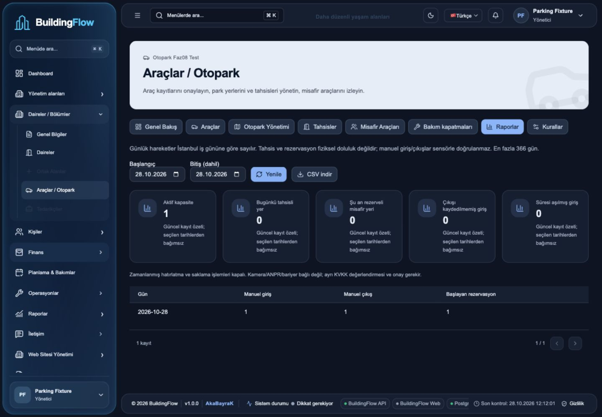

# OTOPARK FAZ08 — Final kalite ve yayın kontrolü

28.10.2026 • Plan08/08 • [Issue80](https://github.com/AkaBayraK/BuildingFlow/issues/80) • [Teslim yorumu](https://github.com/AkaBayraK/BuildingFlow/issues/80#issuecomment-6465364304) • **Yerel doğrulama tamam; yayın BLOKE.**

## Kapsam, yetki ve kaynak

Kullanıcı Faz08'e geçilmesini isteyerek Faz07 teknik teslimini kabul etti; #79completed. Sonraki devam ve giriş yardımı talepleri aynı Faz08 kapsamındadır. Paket ana checkout'ta `BuildingFlow-Araclar-Otopark/MASTER_PROMPT.md`, `FAZ-08.md` ve8FAZdosyası; pakette PHASES.md yoktur. UI MASTER/PHASES `frontend/buildingflow-ui-plan/` altında12aşama, mobil15faz ayrı kalır. Root/frontend/mobil yönergeleri, mimari/test/yayın/yedek ve lisans kaynakları incelendi. Tek agent; mevcut akadev-phase/verify/security/license/docs kullanıldı, yeni agent/MCP/paket adı kurulmadı.

Kaynak `.claude/worktrees/practical-napier-12a6c6`, branch `claude/project-thread-9pmvkm`. Önceki05–07değişiklikleri ve main'deki diğer işler korundu; commit/push/PR/uzakCI/üretime dağıtım yoktur. Geçici test haricinde DB/IdP/.env/rol/servis değiştirilmedi. Kök başlangıç prompt'u bitmiş aşamaları yeniden başlatmadı.

## Son değişiklikler ve doğrulanmış bulgular

1. **Rol sınırı (P2), düzeltildi:** eski legacy AraçlarımGET yalnız oturuma bakıyordu; bağlı kişi+güncel ilişki bulunan ACCOUNTANT ile beklenen403yerine200 negatif testte üretildi. Application/Parking.Resident helper artık OWNER/TENANT/RESIDENT veya yönetim rolü ister; üç uç403 ve mevcut sakin olumlu akışı final testte geçti. Aktif ilişki/sahiplik kontrolleri kaldırılmadı, mobil context yetkisi açılmadı. Bu kişiler arası veri sızıntısı/pentest sertifikası iddiası değildir; belirlenen rol sözleşmesi ihlalidir.
2. **UUID içerik tutarlılığı (P2), düzeltildi:** yönetici ve legacy sakin araç replay kontrolüne trim-normalize marka/model/renk eklendi; farklı metadata409, aynı normalize metadata aynıID. Mobilde mevcut tam kontrol korundu. Güncel kaydın tip/metadata düzenlemesiyle eski create replay409olabilir; kör yeni UUID ile çoğaltma yapılmaz. Yeni entity/migration yoktur.
3. **Klavye/erişilebilirlik (P3), düzeltildi:** ParkingWorkspace sekmeleri tek Tab durağı, sol/sağ, Home/End, sarma ve seçimle taşınan odak kullanır. Gerçek son Docker imajında gözlendi; ikonlar aria-hidden, etiketler anlamı taşır.
4. **Saklama metni, düzeltildi:** Kurallar TR/EN eski gelecek-faz anonimleştirme ifadesi yerine gerçek opt-in alan maskeleme ve korunan kişi/daire/audit sınırını gösterir.
5. **Mevcut node-forge1.4.0→1.4.2 yaması:** aynı mobil kilitte yalnız bir sürüm değişti; yeni paket yolu/ismi yok. Resmi paket LICENSE okundu, BSD-3-Clause seçildi ve tam lisans korundu. Mobilcheck/export ve329/871lisans kontrolü tekrar geçti. Zod high engeli devam eder.
6. **BAKIM, yalnız testler:** PersonRelationPersistence ve LeaseContractPersistence doğrudan DB yarış testlerinde beklenen kaybeden40P01, EF tarafından InvalidOperationException→DbUpdateException olarak sarılabiliyordu. Yakalama yalnız bu sarmal/SQLkodu için genişletildi; tek kazanan korunup DB'de1/3kayıt şartı eklendi. Üretim kişi/kira kuralı veya hata politikası değiştirilmedi.

Yeni standart-kütüphane scriptleri: `scripts/parking-sbom.py`, `scripts/parking-image-inventory.py`; rapor/SBOM/OSenvanteri/UIkanıtları ve mevcut docs/TESTING/progress/roadmap eşlendi. Mobil uygulama kaynak kodu değişmedi; lock ve DEPENDENCIES.tsv yama sürümüne güncellendi. Yeni font/SDK/ikon/görsel yok; önceki tasarım referansı ürüne kopyalanmadı.

## Bu turun gerçek sonuçları

| Kontrol | Sonuç |
|---|---|
| Tam backend, iki ilgisiz opt-in iletişim host'u açıkça dışlanan filtre | **817/817 entegrasyon +413/413unit GEÇTİ,0fail/skip** |
| Web test/typecheck/build | **276/276,0fail/skip; tip ve üretim derlemesi GEÇTİ** |
| Mobil check ve temiz iOS/Android/web export | **154/154,tip/lint ve üç platform GEÇTİ**; native cihaz değildir |
| API/worker/web mevcut Dockerfile build ve non-root süreç | **GEÇTİ**; son imageId envanterde,1654/1654/node |
| Son imajda anonim SSR/CSP/JWT/CORS | **GEÇTİ**; kayıt adı/plaka SSR'da yok, nonceCSP,401/no-store/nosniff, kötü origin reddi |
| Gerçek OIDC/PKCE→API→PostgreSQL browser | **GEÇTİ, kayıtlı senaryo kapsamı**; aşağıya bakınız |
| EF model ve idempotent SQL | **GEÇTİ**; modelde bekleyen değişiklik yok; yeni izole DB'de SQL iki kez uygulandı,49migration |
| Migration/Down/audit/tenant/concurrency regresyonu | **GEÇTİ**,817suite içinde; yeni migration/şema değişikliği yok |
|2000kayıt/7rapor isteği yerel ölçüm | **p50=23,39ms,p95=35,13ms**; nearest-rank p95=7örneğin maksimumu, üretimSLO/yük testi değil |
| Merkezi/mobil lisans metadata | **329/871 GEÇTİ** |
| Güncel web/NuGet audit | **0vulnerability, kaynak hatası yok GEÇTİ** |
| Mobil audit, yama sonrası | **BAŞARISIZ:3high,6moderate,5low**; kapı gevşetilmedi |
| Bildirilen SBOM/OSenvanteri | **1116benzersiz bileşen**, CycloneDX1.6şema yapısı doğrulandı; **97/97/19OSpaketi**; tam binary lisans taraması değildir |
| Release/private-config yardımcı kontrolleri | **6CIgate,geçerli+29güvensiz preflight,3private-config fixture GEÇTİ** |
| Kaynak koruma | Başlangıç1189kaynakta10izinli fark;1179hashkorundu. Eski migration/snapshot/manifest/csproj değişmedi; tek lock sürümü node-forge |

Tam komut: `dotnet test backend/BuildingFlow.sln --no-restore -m:1 --disable-build-servers --filter 'FullyQualifiedName!~ContactNativeHost&FullyQualifiedName!~PhoneContactBrowserHost'`. Final TRX sayımları [08-evidence.json](08-evidence.json) içindedir. İki opt-in host filtreden dışlanır; native kabulü sayılmaz. Gerçek ayrıPG, fixtureS3bucket, ayrıRabbitMQveMailpit kullanıldı. DB/Broker/S3/SMTP sırları kanıta alınmadı.

İlk tam koşu ortak sunucunun bağlantı sınırına takıldığı için durduruldu; server ayarı değiştirilmeden tamamen ayrıPGkonteynerine/Pooling=false'a geçildi. Sonraki815koşuda814geçti, bir mevcut yarış testindeki40P01sarmalı başarısızdı; bir sonraki koşu diğer kira yarış testinde aynı durumu yakaladı. Test sayımındaki yanlış DbSet adı derlemede düzeltildi. İlk hatalı/durdurulmuş/derlenmemiş koşular başarılı sayılmadı. **Son817+413koşu** tüm dar düzeltmeler ve ek negatif/hacim senaryosunu içerir;0skip.

## Gerçek tarayıcı ve erişilebilirlik kanıtı

Yerel Docker web13018, API13017, ayrı Keycloak13019, ayrıPG ve test hesabı kullanıldı. S256PKCE ve kapalı password-grant gerçek IdP üzerinden doğrulandı. Gerçek UI'dan alan/daire/politika/otopark/ziyaretçi yeri, misafir oluşturma→giriş→çıkış, bakım oluşturma→gerekçeli iptal, tarih filtresi, raporda giriş/çıkış/rezervasyon1/1/1veCSV indirildi. Boş formdaki güvenli bildirim/panel odağı,Escape kapanışı, literal `<test>` metninin DOMelementi olmaması,TR/EN/koyu ve375/1440px kontrol edildi. Native tarih alanıyla seçilen günün APIsonucuna yansıması doğrulandı; otomasyon fill davranışı başarı sayılmadı.

Son imajda Home/End/sol/sağ/sarma sonrası seçili ve odaklı sekme aynı, Tabdurağı1veikonaria-hidden gözlendi.375px scrollWidth375,tek görünür kart. Bunlar manuel kapsamlı kabul örnekleridir; otomatik WCAGscanner/kontrast sertifikası, bütün ekran kombinasyonları veya gerçek native kabulü değildir. [UIözet](evidence/08-ui-checks.json), [Dockerözet](evidence/08-docker-smoke.json).

Kullanıcı normal Chrome hesabıyla bu ayrı IdP'ye giriş yapamadı; görülen hata Invalid username or password idi. Yalnız geçici hesapla tazePKCEakışı açıldı, Türkçe görünüm geri getirildi. Gerçek kullanıcının parolası/hesabı/Chromeoturumu değiştirilmedi. İnceleme için test sekmesi ve ayrı web/API/worker/IdP/broker/PGortamı açık bırakıldı; bu üretim sistemi değildir. Geçici regressionDB/rol,SQLprovaDBveMailpit temizlendi. Viewport override sıfırlandı. Bu6konteyner daha sonra yalnız `buildingflow-test-parking08-*` kapsamıyla kapatılır; diğer projeler ve oa08fixture'ları korunur. Özel test ayarları /tmp altında0600/0700kalır; Git'e alınmaz.

## OWASP ve KVKK değerlendirmesi

[OWASP Top10:2025](https://top10.owasp.org/2025/0x00_2025-Introduction/) başlıkları yalnız inceleme çerçevesidir; sertifika/pentest değildir.

| Alan | Kanıt ve sınır |
|---|---|
|A01 erişim | Yönetim/güvenlik aktifPropertyüyeliği; legacy sakinde tokenrolü+güncel kendi ilişkisi; mobil exactcontext/güncelalias. Muhasebeci açığı negatif testle düzeltildi |
|A02 yapılandırma | Üretimpreflight29negatif,anonimSSR/CSP/CORS; yerelHTTPDevelopment üretimHTTPSkanıtı değildir |
|A03 tedarik zinciri |1116SBOM,lockhash,329/871lisans,0web/NuGetaudit; mobilZodhighkapısı açık |
|A04 kriptografi |GerçekS256PKCE,JWTimza/issuer/audience/lifetime ve mevcut şifreli cache testleri; native donanım deposu ayrıca |
|A05 enjeksiyon |EF/parametreliSQL,allowlist/uzunluklar,literalmarkup,CSVyalnızgün/sayı; bağımsızDASTtam tarama yok |
|A06 tasarım |Propertykilidi,kota/çakışma,yetki sonrasıversion,UUIDtam metadata ve tekrarlıjobtestleri; ölçülmüş doluluk yok |
|A07 kimlik |Passwordgrantkapalı,gerçekOIDCvebozuk/anonimJWT401; yönetilen canlırealm'e dokunulmadı |
|A08 bütünlük |Immutableaudit/optimisticversion,compositeFK,Downkoruması,idempotentSQLikiapply |
|A09 güvenli kayıt |Parking kodunda plaka/kişi/requestbodylogsink'i yok; güvenli sabit worker olayı; mevcut telemetri gizlilik testleri suite'de |
|A10 hatalar |ProblemDetails/kodlu400/403/404/409,transactionrollback,replay/stale/çakışma negatif testleri; bilinmeyen hatalar saklanır |

Saklama alan maskelemesidir; kimlik/audit ilişkileri, yedek ve önceden indirilmiş/offline kopya kaldığından tam anonimleştirme/imha uygunluğu iddia edilmez. Worker bayrağı kapalı; kamera/ANPR/QR/bariyer bağlı değildir. Ayrı donanım/KVKK değerlendirmesi gereği Faz07raporunda korunur. ACCOUNTANT'a kişi/plaka yetkisi açılmadı; bulunan legacyrol sınırı kapatıldı.

## Lisans, SBOM ve kalan yayın engelleri

[SBOM](evidence/08-declared.cdx.json) web/mobil lock ve restoreNuGet bileşenlerini dev/test/platform varyantlarıyla düzleştirir; dependencygraph/nativeSDK/tüm bundled binary kapsamı iddia etmez. Resmi CycloneDX1.6şeması zaten kuruluAjv ile doğrulandı; kullanılmayan IRI/IDNformatları validator'da yoktur, bu alanlar SBOM'da bulunmaz. Yeni scanner/SDK/paket/font/görsel kurulmadı. [OSenvanteri](evidence/08-container-inventory.json) immutableimageIdvepackageDBhash içerir; bütün OS/native lisanslarını onaylanmış saymaz. LGPLlibvips,AGPLservisler,kuruluş abonelikleri ve hedef dağıtım bildirim/kaynak/yeniden bağlama yükümlülükleri ayrıca kabul ister. [Lisans kaydı](../licenses.md).

**Gerçek engel:** [Zodduyurusu](https://github.com/advisories/GHSA-mrhx-c7xc-m3w5) `<4.6.6` aralığını etkilenmiş sayar. MevcutExpoCLI57.0.29ve incelenen57.0.32 `^3.25.76` ister; npm zincirinde zod/@expo/cli/expo üçhighkayıt üretir. Node-forge1.4.2yaması onun uyarısını kaldırdı. Zod4zorlaması,Expo51otomatikdowngrade veya auditmuafiyeti yapılmadı. Uyarı CLIbağımlılıkzincirindedir; nativebinaryçağrıgrafiği taranmadı ve bu nedenle etkilenmez varsayımı yapılmaz. Uyumlu upstream çözüm veya ayrıca ele alınacakSDK/uyumluluk düzeltmesi ve tekrarcheck/audit gerekir.

ÜretimHTTPS/domain/sırlar,uzakCI/commit/PR,gerçeknativecihaz,otomatikWCAG/DAST/yük/pentest ve tam binary lisans kabulü **çalıştırılmadı/doğrulanmadı**. Yeni sürüm/lisans politikası sessizce değişmedi. Commit/PR/CIURL üretilmedi; bu yerel test koşusu remoteCI olarak sunulmaz. [Yayın kontrolü](08-release-checklist.md).

## Rollback ve karar

Eski migration/snapshot değiştirilmedi. AutoMigrate açık sonraki gerçekAPIbaşlangıcında Faz05/07pendingmigration uygulanabilir; bu tur yalnız fixture'a uygulandı. API/worker sürümleri birlikte ele alınır; önce worker/yazımlar durdurulur. Maskelenmiş veri varsa Downkoruması aşılmaz ve eski binary'nin maskeleme dışlama davranışı olmadığı unutulmaz. İleri düzeltme tercih edilir; yedek geri dönüş yalnız yeni izole hedefe ve mevcut quiescedprosedüre göre. Node-forge1.4.0'a dönüş bilinen uyarıyı geri getirir. UIkeyboardvelegacyrol düzeltmeleri geri alınırsa ilgili güvenlik/erişilebilirlik hataları geri gelir.

Tur2/3=%66,67; Adım03 yayın kapısı **BLOKE** (Zodhigh ve tam dağıtım/native/hedef kabulü). Faz08 resmi5/8=%62,50: kapsam,security,testkanıtı,dosya/yerelkanıt,risk/rollback tamam; tüm hedefler, tam lisans/dağıtım kabulü ve kullanıcı final onayı açık. Ürünroadmap28kayıt148/159=%93,08. Yalnız doğrulanmış yerel kalite görevi işaretlendi; release görevi planlı. #80açık; yeni faz başlatılmadı. Sonraki somut adım Zod/Expo güvenlik uyumluluğu ve kalan yayın kapılarının kapanmasıdır.

Giriş token: BİLGİ MEVCUT DEĞİL. Çıkış token: BİLGİ MEVCUT DEĞİL. Toplam token: BİLGİ MEVCUT DEĞİL. Kalan context: BİLGİ MEVCUT DEĞİL.

28.10.2026 son Codexusage/rateLimitsByLimitId.codex:300dk kullanılan%59/kalan%41,reset28.10.2026 16:43:32;10080dk kullanılan%9/kalan%91,reset04.11.2026 11:43:32 Europe/Istanbul. Hesap kotası bu sohbetin token tüketimi değildir.

## Son imaj görseli

[375px](evidence/08-final-375.png) • [TRgerçekE2E](evidence/08-real-oidc-report-tr.png) • [EN/koyu](evidence/08-real-oidc-report-en-dark.png)
