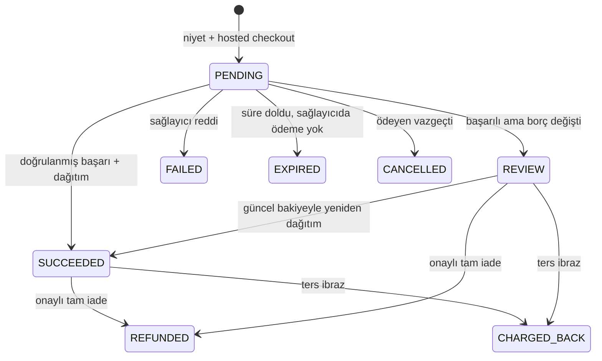

# BF-PAY FAZ 01 — Domain ve ödeme iş kuralları (ADR)

Tarih: 23.10.2026. Durum: **Kabul edildi** (kullanıcı kodlamayı başlattı). Önceki faz: [00-discovery.md](00-discovery.md).

## ADR-1 Borç türü: aidat ve ek ödeme

- `DuesAssessment` ve `DuesCharge` yeni `kind` alanı taşır: `DUES` (aidat) veya `EXTRA` (ek ödeme). Eski kayıtlar `DUES` ile doldurulur.
- `EXTRA` için `category` zorunludur: `FIXTURE` (demirbaş), `REPAIR` (onarım/tadilat), `HEATING` (yakıt/ısınma), `UTILITY` (ortak tüketim), `INSURANCE` (sigorta), `OTHER` (diğer). `DUES` için kategori boştur.
- Unit + dönem tekilliği yalnız `DUES` için geçerlidir; aynı ay içinde birden çok ek ödeme çıkarılabilir. Ek ödemenin mükerrer gönderimi UUID + fingerprint ile korunur.
- Borç türü tahakkuk anında snapshot olarak `dues_charges` satırına da yazılır; sonradan değişmez.
- Fingerprint geriye uyumludur: `DUES` isteğinin özeti değişmez, `EXTRA` için tür ve kategori özete eklenir.
- **Gecikme tazminatı:** KMK m.20 ortak gider ve avans paylarının gecikmesini kapsar. Ek ödeme borçları da aynı `LatePenaltyEngine` ile, aynı uygula anahtarı ve kanuni aylık %5 · gün/30 kuralıyla işler; ayrı motor yazılmaz.
- Tahsilat (manuel veya online) her iki türü aynı `Payment`/`PaymentAllocation` ile kapatır.

## ADR-2 Fon akışı ve hukuki model

- Ödeme doğrudan yönetim alanının kendi üye işyeri hesabına (sağlayıcıdaki merchant) yapılır. BuildingFlow parayı tutmaz, toplamaz, dağıtmaz.
- Komisyon politikası yalnız `ABSORBED` (yönetim üstlenir). Ödeyene yansıtma kapalıdır; açılması hukuki onay kapısıdır.
- Kart numarası/CVV hiçbir katmanda alınmaz, saklanmaz, loglanmaz; yalnız sağlayıcının hosted checkout sayfası kullanılır.
- Canlı ortam (`LIVE`) üye işyeri kaydı reddedilir; yalnız `SANDBOX`. Canlı anahtar, canlı tahsilat ve hesap aktivasyonu ayrı açık onay ister (FAZ 12).

## ADR-3 Kavramlar (mevcut modellerle çakışmadan)

| Kavram | Tablo | Not |
|---|---|---|
| Sağlayıcı kataloğu | `payment_providers` + kod sahipli adaptör listesi | SUPER_ADMIN global aç/kapat; adaptörü olmayan kod açılamaz |
| Yönetim alanı ödeme ayarları | `property_payment_settings` | Online açık/kapalı, kısmi ödeme, makbuz öneki, IBAN gösterimi, çift onay, komisyon politikası |
| Banka hesabı | `payment_bank_accounts` | Çoklu hesap, IBAN mod-97, varsayılan, geçerlilik, amaç (ALL/DUES/EXTRA), opsiyonel blok |
| Üye işyeri (MerchantBinding) | `payment_merchant_accounts` | Sağlayıcı, merchant id, gizli anahtar **referansı**, ortam, opsiyonel blok, varsayılan |
| Ödeme niyeti | `payment_intents` + `payment_intent_lines` | Sunucu hesaplı tutar ve borç rezervasyonu |
| Sağlayıcı olayı | `payment_provider_events` | Webhook gelen kutusu, `(provider, event_id)` tekil |
| Tahsilat | **mevcut** `payments` + `payment_allocations` | Yeni yöntem `ONLINE_CARD` |
| Makbuz | `payment_receipts` | Yönetim alanı + yıl sıralı numara |
| Defter | `payment_ledger_entries` | Değişmez, yalnız ekleme; ters kayıt ile düzeltme |
| İade | `payment_refunds` | Talep + farklı yetkili onayı |
| Mutabakat kalemi | `payment_reconciliation_items` | Manuel inceleme kuyruğu |

Hepsi `BaseEntity` (sekiz zorunlu kolon), UUID, version, audit; finans geçmişi soft-delete edilmez.

## ADR-4 Yönlendirme

- Ödeme niyeti oluşturulurken üye işyeri seçimi: Unit'in bloğuna bağlı aktif varsayılan merchant, yoksa yönetim alanının blok bağımsız varsayılanı. Bulunamazsa online ödeme kapalıdır.
- Sakinlere gösterilen IBAN: Unit bloğu + borç türü amacına uyan aktif, geçerlilik aralığındaki hesaplar; blok hesabı yoksa yönetim alanı geneli.

## ADR-5 Ödeme yükümlüsü

- Borç Unit'e aittir. Online ödemeyi yalnız o Unit için mobil oturumda OWNER/TENANT bağlamı olan kullanıcı başlatabilir ve yalnız `ResidentCharges` kuralının gösterdiği borçları (UNIT borcu + kendisinin borçlu muhatap olduğu kişisel borç) seçebilir.
- Kişi, kullanıcı, malik/kiracı ilişkisi ayrı kalır; ödeme yapan kullanıcı kimliği (`payer_user_id`) audit içindir, borcu kişiye taşımaz.
- Yöneticiler sakin adına online ödeme başlatmaz; mevcut manuel tahsilatı kullanır.

## ADR-6 Tutar ve kısmi ödeme

- İstemci yalnız borç kimliklerini ve (kısmi ödemede) toplam tutarı gönderir; satır tutarlarını sunucu hesaplar.
- Tam ödemede her seçili borç için: o güne kadarki gecikme tazminatı (kesinleşmiş bakiye + bekleyen) + kalan ana para.
- Kısmi ödeme yalnız ayar açıksa; dağıtım BF-LATE önerisiyle aynıdır (en eski borç önce, tazminat ana paradan önce — TBK m.100/101). Öneri kodu `LatePenaltyEngine.Suggest` ile tek yerde tutulur, manuel önizleme de onu kullanır.
- Manuel tahsilatta operatör dağıtımı (K2) değişmez.

## ADR-7 Durum makinesi (PaymentIntent)

- Geçişler domain'de tek yerde (`PaymentIntent.MoveTo`) doğrulanır; geçersiz geçiş 409.
- İstemcinin dönüşü başarı sayılmaz. Başarı = imzalı webhook **ve** sağlayıcı durum sorgusu (ya da sorgu ile mutabakat job'ı). Webhook yükündeki durum tek başına kullanılmaz.
- Mükerrer webhook `(provider, event_id)` tekilliğiyle no-op; sırasız olayda sorgu sonucu esastır; terminal durum geri dönmez.
- Süre: niyet 30 dakika geçerlidir; süresi dolan niyet sağlayıcıya sorulmadan EXPIRED yapılmaz.
- Rezervasyon: aktif (PENDING) niyetteki bir borç için ikinci niyet 409. Manuel tahsilat engellenmez; çakışma olursa niyet REVIEW'a düşer.

## ADR-8 Tahsilat, makbuz ve defter

- Doğrulanmış başarıda Property kilidi altında tek transaction: `Payment(ONLINE_CARD)` + mevcut dağıtım/tazminat kesinleştirme + makbuz + defter `COLLECTION`.
- Borç değişmişse (iptal, bakiye/tazminat yetersiz) para alınmış ama dağıtılamamıştır: niyet REVIEW, defter `UNALLOCATED_RECEIPT`, mutabakat kalemi açılır.
- Makbuz numarası `{önek}-{yıl}-{000001}` yönetim alanı ve yıl bazında kilit altında sıralı; manuel tahsilatlar da numara alır. Makbuz mali/fiskal belge değildir.
- Manuel tahsilat iptali defterde `COLLECTION_REVERSAL`; online iade `ONLINE_REFUND`; ters ibraz `CHARGEBACK`. Satırlar silinmez/güncellenmez.

## ADR-9 İade ve ters ibraz

- Yalnız tam iade (kısmi iade sonraki iterasyon). Talep: SITE_ADMIN/MANAGER/SUPER_ADMIN; onay: SITE_ADMIN/SUPER_ADMIN ve talep edenden farklı kişi.
- Onayda Property kilidi altında: bağlı tahsilat iptal edilir (mevcut ters alma + tazminat yeniden kurma), sağlayıcı iadesi çağrılır, başarılıysa commit; sağlayıcı reddederse transaction geri alınır, iade FAILED.
- Ters ibraz sağlayıcı olayı + durum sorgusuyla işlenir; tahsilat geri alınamıyorsa (sonraki tazminat ödemesi vb.) mutabakat kalemi açılır.

## Yetki matrisi

| İşlem | SUPER_ADMIN | SITE_ADMIN | MANAGER | ACCOUNTANT | OWNER/TENANT (mobil) |
|---|---|---|---|---|---|
| Sağlayıcı kataloğu aç/kapat | ✓ | – | – | – | – |
| Ödeme ayarları oku | ✓ | ✓ | ✓ | ✓ | – |
| Ödeme ayarları değiştir | ✓ | ✓ | – | – | – |
| Banka hesabı / üye işyeri öner | ✓ | ✓ | ✓ | – | – |
| Banka hesabı onayla / kapat, merchant aç/kapat | ✓ | ✓ (çift onayda farklı kişi) | – | – | – |
| Online ödemeleri, defteri, mutabakatı oku | ✓ | ✓ | ✓ | ✓ | – |
| İade talebi | ✓ | ✓ | ✓ | – | – |
| İade onayı | ✓ | ✓ (talep edenden farklı) | – | – | – |
| Mutabakat kalemi çöz | ✓ | ✓ | ✓ | – | – |
| Ödeme seçenekleri / IBAN gör, online ödeme başlat, kendi niyetini izle | – | – | – | – | ✓ (kendi Unit bağlamı) |

SUPER_ADMIN dışındaki yönetici rolleri için aktif `PropertyMembership` zorunludur; kapsam dışı kayıt 404, yetersiz rol 403. ACCOUNTANT'a kişi verisi açılmaz (yanıtlar kişi adı taşımaz).

## Kabul kriterleri

1. Ek ödeme kategorisiyle tahakkuk edilir; aynı ayda aidat + birden çok ek ödeme bulunabilir; ikinci aynı ay aidatı hâlâ 409.
2. Ek ödeme borcu gecikince tazminat aynı motorla hesaplanır; manuel ve online tahsilatla kapatılır.
3. Sunucu tutarı yeniden hesaplar; istemci tutarı/success'i güvenilmez.
4. Webhook imzası, zaman damgası, tekrar ve sırasız olay korunur; durum sorgusu olmadan tahsilat yazılmaz.
5. Aynı borç için eşzamanlı iki niyet açılamaz; aynı niyet iki kez tahsil edilmez.
6. Makbuz numarası tekil ve sıralıdır; iptal/iade kaydı siler değil ters kayıt üretir.
7. Yönetim alanı izolasyonu: başka alanın hesabı, merchant'ı, niyeti, defteri görünmez.
8. Gizli anahtar API/UI/log'da görünmez; yalnız referans adı tutulur.
9. Mobil çevrimdışı iken ödeme başlatılamaz, kuyruğa alınmaz, otomatik tekrarlanmaz.

## Testler / geri alma

Bu faz belge fazıdır; test çalıştırılmadı. Geri alma: belgeyi silmek.
