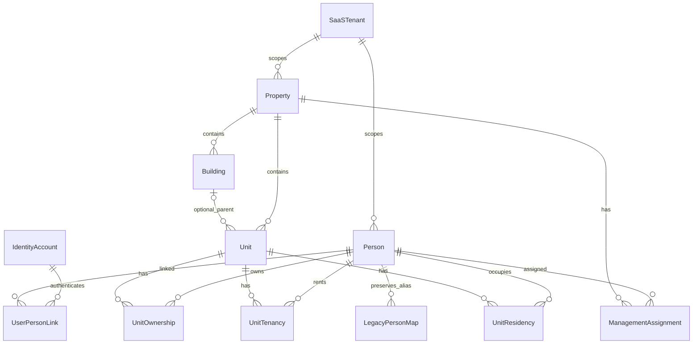

# PERSON REFACTOR — FAZ 01: mevcut yapı analizi

Tarih: 16.10.2026 (Europe/Istanbul). Durum: **analiz teslim edildi, kullanıcı kabulü bekleniyor**. Plan: `BuildingFlow-Person-Refactor-Prompt-Paketi/PHASES.md`, toplam **11 faz**. Bu plan mevcut İŞ/UI/AI ve 15 fazlı mobil planından ayrıdır. FAZ 02 başlatılmadı.

## 1. Kapsam, yetki ve yöntem

Kullanıcının seçtiği paketteki MASTER_PROMPT.md, STANDARDS.md, PHASES.md, AGENTS.md ve phases/PHASE-01.md okundu. Sonraki faz dosyaları yalnız görev kapsamlarını ve bağımlılıklarını doğru kaydetmek için okundu; uygulanmadı. Paketi köke kopyalama veya mevcut AGENTS.md dosyasını ezme yapılmadı. Kök/frontend/mobil yönergeleri, mevcut API/progress/test belgeleri ve hedefli kaynak kodları incelendi.

Bu tur izin verilen tek kalıcı yerel çıktı bu rapordur. Kod, yapılandırma, prompt paketi, migration, model snapshot, bağımlılık, kilit dosyası, ürün yol haritası ve ortak progress belgeleri değiştirilmedi. Canlı DB/Keycloak/SQLite/kişisel veri veya credential okunmadı; servis başlatılmadı. Önceden ortak çalışma ağacında çok sayıda değişiklik vardı; mevcut `main` dalı korundu. Başlangıç git durumu ve kaynak hash envanteri yalnız `/tmp` altında tutularak son kontrol için kullanıldı.

Kullanıcı ayrıca bütün fazlar için görev açma ve her faz sonunda ilerletme yetkisi verdi. Bu nedenle salt okunur yerel incelemeye ek olarak GitHub Project 3 üzerinde görev takibi yapıldı. Görev oluşturmak sonraki faza uygulama onayı değildir. Repo: `AkaBayraK/BuildingFlow`; gerçek yerel yol `BuildingFlow`.

Kullanılan yerel skill yönergeleri: `.claude/skills/akadev-phase/SKILL.md` ve `.claude/skills/akadev-audit/SKILL.md`. Tek agent; alt agent yok. Audit'in salt okunur sınırı korunur; ayrıca istenen rapor ve GitHub görevleri kullanıcı yetkisi kapsamındadır.

## 2. Sonuç ve mevcut teknoloji

**Person henüz yönetim alanından bağımsız değildir.** `Person.PropertyId` zorunludur; kişi/ilişki/finans FK'leri ve API'ler bu alan üzerinden izole edilir. Buna karşılık malik/kiracı/sakin zaten kişiye yapışık boolean değildir: tarihli `UnitOccupancy` kayıtlarıdır. Kişi bağımsızlaştırma basit bir kolon kaldırma işi olarak ele alınamaz.

- Backend: .NET10 modular monolith; Domain/Application/Infrastructure/API/Worker. EF Core10.0.12, Npgsql provider10.0.3; sürümler kaynak manifestlerden okundu, runtime sürümü sorgulanmadı.
- Merkez: Next.js16.4.0, React19.3.0, next-intl, mevcut shadcn/Radix ve TanStack Table. Auth Keycloak Authorization Code+S256 PKCE.
- Mobil: Expo57.0.28 aralığı, React Native0.86.3, TypeScript, expo-sqlite/SecureStore/Crypto. Native SQLCipher zorunlu kontrolü var; özel fotoğraf/taslaklar AES-GCM dosyalarında.
- Storage: mevcut özel SeaweedFS üzerinden dosya servisi; Person refactor için yeni dosya deposu gerekmiyor.

### Mevcut kavram eşlemesi

| Paketteki ad | Gerçek kaynak karşılığı | Durum |
|---|---|---|
| ManagementArea | Property | APARTMENT/SITE/RESIDENCE/MIXED; isim değiştirmek gerekmiyor |
| Block | Building | Property altında opsiyonel; apartmanda sahte blok yok |
| Unit | Unit | PropertyId her zaman, BuildingId isteğe bağlı |
| Person | Person / people | Zorunlu PropertyId; gerçek/tüzel, yerli/yabancı, kimlik/iletişim, LinkedUserId |
| User | Keycloak hesabı + JWT sub + KeycloakUser DTO | Yerel bağımsız domain User tablosu tespit edilmedi |
| Malik/kiracı/sakin | UnitOccupancy.Type | OWNER/TENANT/RESIDENT; tarihli ve çoklu ilişki mevcut |
| Yönetici görevi | Realm rolü + PropertyMembership | Tarihli Person tabanlı ManagementAssignment yok |
| SaaS tenant | Ayrı Tenant/TenantId modeli tespit edilmedi | Property ile aynı şey olduğu varsayılamaz; ürün kararı gerekir |

Kanıtlar: `backend/src/BuildingFlow.Domain/Person.cs:6–14`, `UnitOccupancy.cs:3–25`, `PropertyMembership.cs:4–14`; `backend/src/BuildingFlow.Infrastructure/PeopleConfigurations.cs:7–59`, `EntityConfigurations.cs:45–130`; `backend/src/BuildingFlow.Application/Users.cs:7–18`, `backend/Directory.Build.props:1`; mobil ve frontend package.json.

## 3. Person, kullanıcı ve erişim sınırları

### Person ve daire ilişkisi

Person oluşturulması Property kimliği ister. Kimlik türü/ülke/numara, doğum/cinsiyet/adres ve LinkedUserId profile alanlarıdır; geçmiş profile bilgisi eksik legacy kayıtlar nullable'dır. Uygulama yeni profile girişinde telefon/e-posta ve kimlik biçimini doğrular; bu doğrulama dış bir kimlik doğrulama servisinden teyit anlamına gelmez. `PersonKind=LEGAL` desteklenir; kullanıcı ile tüzel kişi temsil/vekâlet ilişkisi ayrı modellenmemiştir.

`people` üzerinde `(PropertyId,Id)` alternate key ve Property FK vardır. UnitOccupancy aynı Property içindeki Person ve Unit'e composite FK ile bağlıdır. Rol aynı kişide farklı dairelerde ve aynı dairede farklı kayıtlar üzerinden çoklanabilir. Tarihler DateOnly, Europe/Istanbul iş günü, başlangıç/bitiş dahil. Aynı kişi/daire/rol tarih çakışması ve primary-contact çakışması store tarafından Property satır kilidi altında denetlenir. Açık uçlu ilişkiler için partial unique index vardır. Biten ilişki doğrudan yeniden yazılmaz. Ortak malik desteklenir ancak **pay oranı alanı yoktur**.

Kişi pasifleştirme/silme, süren veya gelecekte biten ilişkiler varken engellenir. Soft-delete, audit ve version merkezi BaseEntity/AuditInterceptor ile uygulanır. Ortak query filter yalnız `IsDeleted` filtresidir; **tenant/üyelik veya IsEnabled global filtresi değildir**. Yetki ve etkinlik filtreleri her sorguda açık biçimde korunmalıdır.

Kanıt: `Person.cs:23–65`; `PeopleConfigurations.cs:25–59`; `PeopleStore.cs:17–28,111–138,185–228`; `EntityConfigurations.cs:9–21`; `AuditInterceptor.cs`.

### Kullanıcı ve kişi bağlantıları

Keycloak subject, `Person.LinkedUserId` string alanında tutulur; Keycloak ile ilişkisel DB arasında FK yoktur. Aynı hesabın farklı alanlardaki ayrı Person kayıtlarına bağlanması yapısal olarak mümkündür. Kaynakta LinkedUserId ve IdentityNumber için benzersiz DB index tespit edilmedi.

Bağlama girişleri eşdeğer değildir:

1. `UserDirectoryStore.LinkAsync`: aynı Property içinde hesap başka kişiye bağlıysa reddeder; Property kilidi + kişi version'ı, completed profile ve aktif kişi/alan ister; üyeliği açar/etkinleştirir. Unlink, kişi bağını kaldırır **üyeliği korur**.
2. `MobileOnboardingStore.LinkAsync`: tek kullanımlık kod hash'i, normalize ad/telefon/e-posta, aktif ilişki ve aynı alanda başka kişi bağı olmaması denetlenir; üyelik açılır/etkinleşir; kod tüketilir, deneme kaydı tutulur.
3. `PeopleStore.CreateAsync/UpdateAsync`: `CheckLinked` yalnız seçilen hesabın aynı Property'de aktif üyeliğini kontrol eder; diğer iki girişteki “hesap başına alanda tek kişi” kontrolü burada tespit edilmedi.

Bu fark kaynak incelemesiyle doğrulanmıştır; canlı hesap veya saldırı testi yapılmamıştır. FAZ02, User→Person cardinality ve tüm yazım girişlerinin ortak kuralını belirlemelidir. Profil tamamlanma ve hesabın gerçekliği kontrolleri de tek sözleşmeye taşınmalıdır.

Kanıt: `UserDirectoryStore.cs:43–69`; `MobileOnboardingStore.cs:37–65`; `PeopleStore.cs:64–75,111–127`; `PeopleConfigurations.cs:16–32`.

### Yetki kaynakları

- Merkez People endpoint grubu `CanManagePeople`: gerçek JWT SUPER_ADMIN/SITE_ADMIN/MANAGER; PeopleService aynı rol denetimini yapar; PeopleStore kullanıcı üyeliği üzerinden Property scope uygular. ACCOUNTANT'a kişi profili erişimi açılmaz.
- SUPER_ADMIN mevcut global scope istisnasıdır; yeni merkezi kimlik registry'sine otomatik sınırsız PII erişim politikası olarak taşınmamalıdır.
- Mobil yönetici bağlamları realm rolü + aktif Property üyeliğinden; OWNER/TENANT/RESIDENT bağlamları LinkedUserId + aktif üyelik + tarihli Occupancy ve aktif parent'lardan üretilir. Kullanıcının seçtiği context role tek başına yetki sağlamaz.
- Person/Unit geçmişinde IgnoreQueryFilters vardır; kaynak store bunu açık Property/üyelik filtreleriyle sınırlar. Yeni merkezi join bu sınırı kaybetmemelidir.
- Şu anda PERSON kayıt/ilişkileri olmadan MANAGER realm rolü + üyeliğiyle yönetim erişimi mümkündür; tarihli yönetim görevi ile realm rolünün geçişte nasıl birleştirileceği FAZ05 kararıdır.

Kanıt: `Api/Program.cs:31–38`; `Api/PeopleEndpoints.cs:7–34`; `Application/People.cs` PeopleService.Access; `Infrastructure/PeopleStore.cs:12–16,185–192`; `MobileSessionStore.cs:8–36`; `MobileOwnerStore.cs:11–21`.

## 4. Mevcut verinin kopyaları ve eşleştirme anahtarları

**Canlı satır taraması yapılmadı. Gerçek mükerrer kişi sayısı, orphan sayısı, satır sayımları ve mevcut kayıt eşleştirmeleri DOĞRULANAMADI.** Buradaki kopyalar kaynakta görülen ayrı veri sahiplikleridir.

| Kaynak | Tutulan veri | Refactor etkisi |
|---|---|---|
| people | Alan bazlı kimlik, ad, iletişim, hesap bağı | Aynı gerçek kişi farklı Property'lerde ayrı kaydedilebilir; gerçek tekrar sayısı bilinmiyor |
| Keycloak | Hesap adı, e-posta, ad/soyad, rol ve etkinlik | Kimlik doğrulama kaynağı; kişisel domain kaydıyla otomatik eşit varsayılamaz |
| MobileProfile | OwnerUserId + ad/soyad/telefon/fotoğraf | Person'dan ayrı profil; alan yöneticisinin değişikliğiyle otomatik eşitlenmez |
| DuesChargeParty | PersonId/OccupancyId ve kişi adı/rol/tarih snapshot'ı | Geçmişin kanıtı; güncel Person merge sonucu yeniden yazılmaz |
| PersonMessage | Property/Person/recipient subject ve içerik | Eski alıcı/scope korunmalı; merge yeni alıcıya eski mesaj yetkisi vermemeli |
| SmsMessage | Property, optional PersonId ve şifreli gönderim payload'ı | Refactor ID haritasında ve saklama politikası kapsamında ayrıca ele alınmalı |
| MobileRegistration / PersonLinkAttempt | Hesap kayıt makbuzu ve bağlama denemeleri | Eski UUID/fingerprint/audit kaybolmamalı; PersonId her yerde FK değildir |
| SQLCipher cache, owner/manager snapshot, outbox | user+context bazlı minimum veri | Merge/context değişiminden sonra eski yetkili snapshot yanlış hesaba açılmamalı |

Kanıt: `Domain/MobileProfile.cs:2–10`; `Infrastructure/MobileProfileStore.cs`; `Domain/DuesChargeParty.cs:5–29`; `Infrastructure/DuesConfigurations.cs:78–99`; `Domain/PersonMessage.cs`; `Infrastructure/PersonMessageStore.cs:12–17`; `SmsConfigurations.cs:64–81`; `MobileOnboardingConfigurations.cs`.

### Anahtar güveni ve önerilen eşleştirme politikası

| Aday anahtar | Güven / sınır | İzin verilen gelecek kullanım |
|---|---|---|
| Mevcut Person UUID | Yüksek, aynı kaydı tanımlar | Tarihçe ve eski API alias'ı için koru; farklı UUID'lerin aynı insan olduğunu ispatlamaz |
| Keycloak `(issuer,sub)` | Hesap kimliği için yüksek | Doğrulanmış hesap bağını taşı; e-posta değişimi hesabı yeniden kimliklendirmesin; tüzel kişi/temsil kararı gerekir |
| Kind + ülke + kimlik türü/numarası | Doğrulanmışsa güçlü aday | Kaynakta biçim doğrulama var; gerçeklik/benzersizlik teyidi yok. Tenant sınırı ve yetkili inceleme olmadan otomatik merge yok |
| Telefon veya e-posta | Düşük/orta | Ortak aile/şirket iletişimi ve devir mümkün; tek başına unique/merge anahtarı yapma |
| Ad/soyad | Düşük | Yalnız öneri; otomatik birleştirme yok |
| PersonCodeHash | Bağlama için tek kullanımlık kanıt | Kalıcı kişi kimliği veya tekrar eşleştirme anahtarı değildir; kod değişir/tüketilir |

Eşleştirme raporları raw kimlik/telefon/e-posta göstermeden sayım ve gerekçe üretmeli. Normalizasyon sürümü, güven seviyesi ve insan onayı audit'te tutulmalı. Cross-tenant kişi varlığını “bu kişi başka müşteride var” sonucu ile ifşa etme. Gerçek veride aday sayımı için ayrıca yetkili, PII içermeyen dry-run gerekir; bu fazda çalıştırılmadı.

## 5. Kavramsal hedef ERD — öneri, kesin FAZ02 şeması değildir

Person yönetim alanından ayrılabilir; görünürlük tenant/alan ilişkileri üzerinden sağlanmalıdır. **Önerilen muhafazakâr başlangıç: Person, SaaS Tenant içinde merkezi; yönetim alanından bağımsızdır.** Bu, farklı müşteri tenantları arasında otomatik ortak kişi/PII deposu anlamına gelmez. Cross-tenant aynı kişi eşleştirme istenirse ayrıca yetkili registry/link tasarımı ve alan/tenant özel profil görünürlüğü gerekir. Mevcut kod bu kararı belirlemiyor.

SaaSTenant, IdentityAccount, UserPersonLink ve LegacyPersonMap şema ekleme kararı değil, açık tasarım sorularını gösteren kavramsal öğelerdir. Yerel User domain tablosu gerekip gerekmediği FAZ02'de seçilmeli; Keycloak hesabı kopyası otomatik eklenmemeli. UserPersonLink cardinality, tenant kapsamı ve tüzel kişi temsil modeli henüz kesinleşmedi. Yeni ilişkilerde ortak sekiz BaseEntity alanı, scope FK ve concurrency zorunluluğu korunur. Rol görünümü bu ilişkilerden hesaplanır; Person'a is_owner/is_tenant/is_manager eklenmez.

UnitOwnership pay oranı isterse numerator/denominator veya kesin decimal, geçerlilik tarihleri ve toplam pay kuralı tanımlanmalı; eski ortak maliklere **eşit pay uydurulmaz**. Eski TENANT veya OWNER ilişkisinden ayrıca RESIDENCY üretilmez. Şu an doluluk raporu TENANT/RESIDENT'i ay sonu dahil sayar, OWNER'ı saymaz; bu anlam FAZ02/04'te açık migration kararı olmadan değişmemeli (`ReportStore.cs:12–13`).

## 6. Etki matrisi ve gelecek dosya planı

Bu dosyalar **bu fazda değiştirilmedi**; ileride onaylı fazın çalışacağı alanlardır.

| Alan / üretici | Tüketici / korunacak sözleşme | Etki ve faz |
|---|---|---|
| Domain/Person, UnitOccupancy, PropertyMembership | EF FK ve tüm sorgular | Tenant sınırı ve merkezi Person tasarımı:02; Person servis refactor:03; ilişki tabloları:04; ManagementAssignment:05 |
| PeopleConfigurations, DuesConfigurations, PersonMessageStore mapping | Composite Property/Person/Unit/Occupancy FK'leri | PersonId tek başına serbest join olmasın; history alias/legacy link kalsın:03–04 |
| People.cs / PeopleStore / PeopleEndpoints | `/properties/{id}/people`, occupancies, unit-parties, account-choices | Eski Property route'larını scoped projection/adapter olarak koru; yeni merkezi API onaysız açılmaz:02–03 |
| Users.cs / UserDirectoryStore / KeycloakAdminClient | Kullanıcı oluşturma/bağlama/çözme ve üyelik | Tüm girişlerde ortak UserPersonLink kuralı; unlink ile üyelik/görev iptalinin ayrımı:03,05,07 |
| MobileOnboardingStore, PersonCodes, backfill | Kayıt ve tek kullanımlık kişi kodu | Tüketilmiş kodu yeniden üretme; global lookup enumeration açma; mapping ve makbuz koru:03–04,08–09 |
| DuesChargeParty, DuesStore, PeopleStore.EndOccupancy | Tahakkuk snapshot, tenant çıkış onayı/iptal | Tarihsel Person/Occupancy kimliklerini ve onaylı chargeId/version listesini koru:04,11 |
| MobileSessionStore, MobileOwnerStore, MobileFinanceQueries, MobileManagerStore, ReportStore | Context/own-unit/finans/doluluk | Yeni ilişki kaynaklarına kontrollü geçiş; rol+nesne scope aynı kalmalı:04–05,07–08 |
| frontend features/people, hierarchy/EntityEditor, management-contracts, users | Alan listesi, kişi sayfası, form/detay, hesap bağı | Aynı RecordList/ManagementPanel, TR/EN, abort/409 ve runtime scope kontrolü:06 |
| AuthGate, PropertyScope, WorkspaceShell, return-path | Giriş sonrası alan/ilişki seçimi | Şu an URL'den Property scope var; görev+ilişki birleşik merkez context selector tespit edilmedi:07 |
| mobile auth/contracts, offline/database+cache, owner/manager/finance | user/context snapshot,24hTTL ve logout purge | Yeni kimlik/permission alanları whitelist; şema yükseltme ve hesap izolasyonu:08 |
| mobile sync/contracts+outbox+engine, requests, profile, notices | Sabit operationId, expectedVersion, fingerprint, makbuz ve tombstone | Eski payloadları/scope anahtarlarını körlemesine yeniden yazma; uyumluluk ve çoklu cihaz:09 |
| Migrations/Designer/snapshot, scripts/db.sh, DatabaseMigration | Kurulum, yükseltme, otomatik sync/startup | Geliştirme sırasında dahi schema değişikliği otomatik uygulamayı tetikleyebilir; kontrollü ortam ve onay:03–04,11 |

## 7. Mobil ve offline durum

Mobil session kontratı `userId, username, contexts[{propertyId,propertyName,unitId,unitNumber,role}], hasMore`; ayrı PersonId/TenantId/permissionRevision alanı yoktur. Context key `property:unit:role` biçimindedir; User değişimi ve scope purge korunur. Birden çok rol aynı kullanıcıda ayrı context olabilir. Sunucu hasMore=true olduğunda istemci eksik kapsamı kabul etmez.

SQLite SCHEMA_VERSION=7; account, session cache/preferences, sync_outbox/requests/state, profile cache/jobs/settings, owner snapshots, request drafts/files/photo cache, notice jobs vardır. Bunlar merkezi kimliğin sahibi değil, yerel kopya ve kuyruktur. DB hesabı ve şifreleme anahtarı SecureStore'da; SQLCipher kontrolü ve WHEN_UNLOCKED_THIS_DEVICE_ONLY var. Fotoğraf BLOB olarak SQLite'a yazılmaz; AES-GCM dosyası DB adı/dosya adı AAD bağlamıyla korunur.

**Mevcut offline açılış PIN/biometri uygulamıyor.** AuthProvider çevrimdışıyken secure refresh varlığı + geçerli önbellekle signedIn durumuna geçebiliyor. Bu cihazın kilit/güvenli depo korumasıyla sınırlı bir erişimdir; yeni FAZ08'in ayrıca cihaz biyometrisi veya offline PIN hedefiyle aynı kabul edilemez. Maksimum cache24saat; sunucudaki iptal çevrimdışıyken anında öğrenilemez. Yeni görev/permission snapshot ve iptal toleransı kararı gerekir; “offline iken güncel sunucu yetkisi doğrulandı” iddiası yoktur.

Sync push/pull/replay sunucuda exact güncel bağlamı yeniden doğrular; outbox sabit UUID ve version409, bounded retry/backoff ve tombstone kullanır. Kişi merkezi hale geldi diye eski role/context anahtarını değiştirerek bekleyen istekleri tekrar CREATE etmek yasaktır. Son merkez talepler işinde yönetim geçmişi sonrası içerik/fotoğraf/silme kilidi zaten eklenmiştir; korunur. Online ödeme sağlayıcısı tespit edilmedi; mevcut finans okuma/merkez tahsilat kaydı gerçek online ödeme akışı değildir. Bu refactor ödeme sağlayıcısı icat etmez.

Kanıt: `mobile/.../auth/contracts.ts:1–25`, `AuthProvider.tsx:66–113,162–163`; `offline/database.ts:8–55,65–83`; `cache.native.ts:9–30,45–66`; `profile/files.native.ts:9–13`; `backend/.../MobileSyncStore.cs:13–16,43–80`.

## 8. Risk kaydı

Dereceler refactor önceliğidir; canlı sömürü veya sertifikalı güvenlik taraması sonucu değildir.

| ID / önem | Bulgu ve kaynak kanıtı | Güven / etki | Öneri |
|---|---|---|---|
| R01 Kritik | Ayrı SaaS tenant sınırı tespit edilmedi; PeopleStore scope'u Property üzerinden kuruyor:12–16 | Yüksek kaynak güveni; Person'ı serbest global aramaya açmak müşteri arası PII ifşasına yol açabilir | FAZ02'de tenant sahipliği ve görünürlük sözleşmesi; cross-tenant lookup varsayılan kapalı |
| R02 Yüksek | Person zorunlu Property ve compositeFK; PeopleConfigurations:28–52, DuesConfigurations:91–93 | Yüksek; kolon kaldırma ilişki/finans/mesaj bütünlüğünü bozar | Expand/mapping/adapter; legacyFK'yi doğrulanmış contract aşamasına kadar tut |
| R03 Yüksek | UserDirectory/MobileOnboarding tek kişi kuralı, PeopleStore.CheckLinked yalnız üyelik | Yüksek; aynı business invariant farklı kapılardan aşılabilir, merkezi link migration'ı belirsizleşir | Önce cardinality kararı, ardından ortak servis+DB constraint ve tüm giriş testleri |
| R04 Yüksek | LinkedUserId/IdentityNumber için uniqueindex yok; alan bazlı kişi kaydı ve ayrı profil depoları | Yüksek yapısal, gerçek tekrar DOĞRULANAMADI | Aynı ad/telefon/e-posta ile otomatik merge yapma; tenant-local dry-run ve manuel kabul |
| R05 Yüksek | DuesChargeParty adı/rolü/tarihi snapshot; OccupancyId compositeFK | Yüksek; merge geçmiş muhatabı/taşınma iptali değiştirebilir | Eski UUID ve immutable snapshot korunsun; alias/map, finans farkı sıfır kabulü |
| R06 Yüksek | Offline açılış ayrıca kullanıcı presence istemiyor; AuthProvider:105–113,cache.native:10 | Yüksek kaynak güveni; FAZ08'in PIN/biometri hedefi henüz karşılanmıyor | Güvenli local-unlock, TTL ve iptal politikası; cihaz kabulü ayrı |
| R07 Yüksek | context key property/unit/role; eski makbuz+fingerprint bu sözleşmeye bağlı | Yüksek; yeniden kimliklendirme duplicate sync/yanlış hesap cache riski | Sürümlü adapter, eski operationId/receipt aynen koruma, account switch/late response testleri |
| R08 Yüksek | MANAGER realm role + membership var; tarihli Person görevi yok | Yüksek; yeni göreve taşınırken yetki genişlemesi veya toplu lockout olabilir | Görev grant/revoke, token gecikmesi, geçiş fallback ve yetki karşılaştırması |
| R09 Orta | OWNER/TENANT ortak mülkiyet var; pay oranı/ayrı fiili oturum yok | Yüksek; eşit pay veya otomatik residency uydurmak iş verisini değiştirir | Pay bilinmiyor durumunu koru; TENANT/RESIDENT/OWNER semantiği ayrı karar |
| R10 Yüksek | scripts/dev.sh api,db.sh sync ve DatabaseMigration mevcut otomatik schema akışı | Yüksek kaynak; sonraki fazda deneysel entity canlı dev şemaya taşınabilir | İzole DB, AutoMigrate kontrolü, migration incelemesi ve yedek kapısı |
| R11 Orta | Tüzel kişi profile destekli, temsilci/vekil UserPerson bağı ayrı değil | Yüksek; kişi hesabı/şirket temsil hakları karıştırılabilir | Natural/Legal hesap cardinality ve temsil sözleşmesi FAZ02 |
| R12 Orta | Mevcut yayın/audit/cihaz kabulü açık kayıtları var | Tarihsel belge kanıtı; güncel güvenlik durumu DOĞRULANAMADI | FAZ10/11'de gerçek SAST/SCA/lisans/cihaz kanıtı üret; eski testleri bu tur geçti sayma |

## 9. Veri geçişi ve rollback önerisi

**Aşağıdaki adımlar gelecek faz planıdır; bu tur SQL, migration veya backfill çalıştırılmadı.**

1. FAZ02'de Tenant/Person/User bağının kimlik ve görünürlük kurallarını sabitle. Yönetim alanı adını değiştirmek veya Keycloak'u kişi kaydı yapmak zorunlu değildir.
2. Yetkili hazırlıkta quiesced yedek/restore provası; mevcut tüm tabloların sayım, veri/audit/version hash'i, FK/orphan, ilişki tarihleri ve finans toplamları PII içermeden baseline alınmalı. Şifreler/dumplar GitHub'a yüklenmez.
3. Expand: yeni merkezi kayıt/tenant scope/link/ilişki/mapping tabloları, sekiz zorunlu alan, scope compositeFK/index/check ve eski satır eşlemesi. Uygulanmış eski migration değiştirilmez. Yeni source+Designer+snapshot birlikte incelenir.
4. Dry-run: kaynak Person UUID başına hedef ve güven/gerekçe; belirsiz eşleşme karantinada. Canonical seçimi onaylanmadan birleştirme yok. İletişim veya eşit isimden otomatik kimlik çıkarımı yok.
5. Backfill: idempotent, küçük transaction/batch ve yeniden başlatılabilir checkpoint. Eski UUID/created_at/by korunur; yeni kayıt audit'i gerçek migration aktörünü taşır. Legacy kayıtları sırf read-model değişti diye yeniden version'lama; gerekiyorsa dönüşüm audit'ini ayrı tut.
6. OWNER→Ownership; TENANT→Tenancy; RESIDENT→Residency birebir ve tarihleri değişmeden. Aynı kişinin aynı dairede çoklu rolü kaybolmaz. Pay oranı bilinmiyor kalır. Tarihsel Occupancy ve DuesChargeParty mapping'i izlenir; eski finans snapshot'ı ve mevcut muhatap FK'leri yerinde tutulabilir.
7. Scoped eski API adapter'ı; yeni okuma için kontrollü switch/shadow karşılaştırma. Dual-write seçilirse tek transaction ve ortak version sahibi açıkça tanımlanmalı; iki bağımsız veri sahibi oluşturulmamalı.
8. Kabul: kaynaksız hedef/orphan=0; her kaynak satır mapping'i; değiştirilmemesi gereken kolon hash'leri aynı; finans tutar/snapshot farkı0; negatif tenant/rol/IDOR testleri; eski mobil UUID replay aynı sonuç ve yeni pull doğru kapsam.
9. Contract (drop/rename/eski yol kapatma) FAZ04/11 içinde dahi **ayrı açık onay** ve eski istemci destek süresi gerektirir. Bu analiz onayı hiçbir drop/backfill yetkisi vermez.

Rollback: yeni özellik okunmadan önce eski uygulama okumasına dönülebilir. Yeni modelde yazı başladıktan sonra Down ile tablo silmek rollback planı değildir; ters mapping, eski biçimde temsil edilebilirlik, finans/mesaj audit koruması ve mutasyonları durdurma/quiesce planı gerekir. Temsil edilemeyen yeni pay/görev/çoklu bağ varsa ileri düzeltme veya doğrulanmış yedek restorasyonu değerlendirilir. Restore mevcut canlı verinin üstüne otomatik çalışmaz; önce izole hedefte kanıt gerekir. Eski kaynak ve UUID eşlemesi doğrulanmış contract süresince tutulmalı.

## 10. Test ve güvenlik planı

### Bu tur gerçek sonuç

- **YAPILDI:** kaynak/entity/config/DTO/UI/mobil keşfi, rol/scope/fingerprint/PII sınırlarının statik incelemesi; mevcut test kaynaklarının envanteri; paket faz ve görev eşliği; rapor bağlantı/kapsam ve kaynak hash kontrolü.
- **ÇALIŞTIRILMADI:** dotnet build/test/EF model-check/migration, npm check/test/build/install, Expo/native build, DB şema/satır sorgusu, canlı API yetki denemesi, Keycloak veya fiziksel cihaz kontrolü. Salt okunur FAZ01 sınırı korunur; uygulama testi başarı sayısı yoktur.
- **ÇALIŞTIRILMADI:** Fortify/SAST, SCA/CVE audit, secret scanner, DAST, MASVS/ASVS sertifikasyonu ve lisans taraması. Kurulu/erişilebilir oldukları veya mevcut bağımlılıkların güncel güvenlik durumu doğrulanmış sayılmaz.
- Önceki docs/TESTING.md ve mobil PHASE raporlarındaki test sayıları tarihsel kanıttır; bu tur yeniden çalıştırılmış değildir.

### Sonraki fazların kabul matrisi

| Test katmanı | Mevcut kaynak | Ek kabul |
|---|---|---|
| Domain | PeopleDomainTests,PersonCodeTests | Çoklu malik/kiracı/sakin, date-boundary, pay oranı bilinmiyor/toplam, tüzel temsil ve görev geçerliliği |
| People/API | PeopleApiTests,PersonProfilesTests,UnitPeopleNavigationTests | Merkezi kişi CRUD+eski scoped adapter, tüm girişlerde link invariantı, foreign Tenant/Property/Person/Unit/assignment,anon401/rol403 |
| User/onboarding | UserManagementTests,MobileOnboardingTests,PersonCodeApiTests | Issuer+sub,çokluProperty,link/unlink/revoke,tek-kullanımlık kod,uniformred,rate-limit,idempotency,account rollback |
| Finans/rapor | DuesParty ve Payment testleri,MobileFinanceTests,Report tests | Tarihsel snapshot/borç bakiyesi/muhatap değişmezliği,çıkışta yalnız onaylıUUID/version,doluluk semantiği |
| Migration | MigrationTests,PersonProfileMigrationTests,PersistenceTests,AutoMigrationTests | Boş kurulum/legacyupgrade/tekrar/backfillretry,8kolon,FK/unique/datecheck,şüpheli eşleşme,veri bulunanDownreddi,restore provası |
| Merkez | management.test.mjs,person-profiles.test.mjs,users tests,return-path testleri | Alan+ilişki context seçimi,TR/EN,RecordList/sağpanel,loading/error/empty/abort/409/odak ve negatif URL |
| Mobil | offline/sync/owner/tenant/profile/registration/requests tests | SQLite7→yenişema,cacheaccount/tenantizolasyonu,24hTTL/unlock/revocation,multi-device,outbox/receipt/photohash/tombstone,logout ve geçyanıt |
| Güvenlik/lisans | ReleaseSecurityTests,scripts/check-licenses.py,release preflight | BOLA/IDOR+fieldminimization,SAST/SCA/secretlogtespiti,licenseSPDX/NOTICE,gerçek cihaz anahtar/backup kanıtı |

Gelecek doğrulamalar ayrı geçici PostgreSQL ve yalnız fixture depolama bucket'ında çalışmalı. Gerçek kullanıcı hesabı/rolü/PII üzerinde mutasyon testi yapılmaz. Yeni bağımlılık bu fazda yoktur; ileride her doğrudan/transitif ek için mevcut lisans politikası uygulanır.

## 11. FAZ02 öncesi açık kararlar

1. SaaS Tenant hangi işletme/müşteri sınırıdır; bir Tenant kaç Property içerebilir? Merkezi Person yalnız bu sınırda mı, yoksa cross-tenant registry gerçekten gerekli mi?
2. Kişi kimlik/iletişim alanlarının sahibi kim: kişi, tenant yöneticisi veya alan bazlı yerel profil mi? Başka alandaki ad/telefon güncellemesi otomatik yayılacak mı?
3. User→Person bağı natural/legal için hangi cardinality'ye sahip olacak; aynı hesabın çoklu alanları nasıl tek kimlikte toplanacak, tüzel temsil yetkisi nasıl kanıtlanacak?
4. Şüpheli kimlik eşleşmesini kim onaylayacak? Normalizasyon, kaynak doğrulama, merge geri alma ve immutable history politikası nedir?
5. Eski OWNER payları bilinmiyorken hedef kayıt null/bilinmiyor kabul edecek mi? Dolulukta eski TENANT semantiği ve ayrı RESIDENCY nasıl korunacak?
6. Yönetim görevi türleri, delegasyon ve tarih/saat sınırı nedir; realm rolleriyle geçiş kuralı ve anlık iptal toleransı nasıl olacak?
7. Mobilde biyometri/PIN zorunluluğu, desteklenmeyen cihaz fallback'i,cacheTTL ve offline iptal toleransı nedir? Rol değişimi ve finans yazımı online kalmalı.
8. Eski merkez/mobil sürümleri ne kadar desteklenecek; onaylı bakım penceresi, yedek/restore hedefi ve contract/drop kapısını kim açacak?

Bu sorular analiz teslimini engellemez; FAZ02 tasarımını karara bağlamak için gereklidir. FAZ02 için kullanıcı onayı alınmadan cevaplar uygulamaya varsayım olarak geçirilmez.

## 12. GitHub görevleri ve kalıcı takip

Pano: [BuildingFlow Project 3](https://github.com/users/AkaBayraK/projects/3). Önce mevcut50pano kaydı ve repo issue listesi incelendi; bu Person refactor faz paketi için eşdeğer kayıt bulunmadı. Mevcut kişi kodu/merkez kullanıcı yönetimi görevleri yeni refactor fazıyla karıştırılmadı. Her görevde canonical faz yolu, faz kabul checklist'i, önceki faz bağımlılığı ve kullanıcı onay kapısı vardır. Her faz sonunda **aynı görev** kanıt ve rapor yolu ile güncellenir; yeni kopya görev açılmaz. Kabul bekleyen faz In review, açıkça kabul edilen faz Done; sonraki faz uygulama onayı ayrı kalır.

| Faz | Görev | Bu teslimde durum |
|---|---|---|
| 01 | [[BF-PERSON][FAZ 01] Mevcut Person Yapısı Analizi](https://github.com/AkaBayraK/BuildingFlow/issues/6) | In review — analiz raporu, kullanıcı kabulü bekleniyor |
| 02 | [[BF-PERSON][FAZ 02] Hedef Veri Modeli ve Sözleşmeler](https://github.com/AkaBayraK/BuildingFlow/issues/7) | Backlog — başlatılmadı |
| 03 | [[BF-PERSON][FAZ 03] Person Backend Refactor](https://github.com/AkaBayraK/BuildingFlow/issues/8) | Backlog — başlatılmadı |
| 04 | [[BF-PERSON][FAZ 04] Daire İlişkileri ve Geçiş Migrasyonu](https://github.com/AkaBayraK/BuildingFlow/issues/9) | Backlog — başlatılmadı |
| 05 | [[BF-PERSON][FAZ 05] Yönetim Görevlendirmeleri](https://github.com/AkaBayraK/BuildingFlow/issues/10) | Backlog — başlatılmadı |
| 06 | [[BF-PERSON][FAZ 06] Kişiler Merkez Ekranı](https://github.com/AkaBayraK/BuildingFlow/issues/11) | Backlog — başlatılmadı |
| 07 | [[BF-PERSON][FAZ 07] Merkez Giriş ve Çalışma Alanları](https://github.com/AkaBayraK/BuildingFlow/issues/12) | Backlog — başlatılmadı |
| 08 | [[BF-PERSON][FAZ 08] Mobil Yerel Kişi ve Rol Modeli](https://github.com/AkaBayraK/BuildingFlow/issues/13) | Backlog — başlatılmadı |
| 09 | [[BF-PERSON][FAZ 09] Mobil Offline CRUD ve Senkronizasyon](https://github.com/AkaBayraK/BuildingFlow/issues/14) | Backlog — başlatılmadı |
| 10 | [[BF-PERSON][FAZ 10] Güvenlik ve Lisans Doğrulaması](https://github.com/AkaBayraK/BuildingFlow/issues/15) | Backlog — başlatılmadı |
| 11 | [[BF-PERSON][FAZ 11] Uçtan Uca Regresyon ve Yayına Hazırlık](https://github.com/AkaBayraK/BuildingFlow/issues/16) | Backlog — başlatılmadı |

## 13. Teslim ve onay kapısı

FAZ01 resmi adımları: 1) yönerge ve kapsam,2) önkoşul/kaynak keşfi,3) etki/dosya haritası,4) salt okunur analiz,5) doğrulama durumu ve risk/test planı,6) bu rapor+görev teslimi. **6/6=%100,00 analiz teslimi**; kullanıcı kabulü bekleniyor. Faz planında **0/11 kabul edilmiş faz**; analiz teslimi ile kullanıcı kabulü ayrı tutulur. İŞ/UI/mobil roadmap sayaçları değiştirilmedi.

Değişen tek repo dosyası: `docs/refactor/person/phase-01-report.md` (yeni). Ortak STATUS/SESSION/CHANGELOG/TESTING ve milestones dosyaları salt okunur fazda değiştirilmedi. Rollback gerektiren kod/şema/bağımlılık işlemi yoktur. GitHub üzerinde yeni11görev ve bunların pano durumları kullanıcı talebiyle oluşturuldu/güncellendi; önceki görevler değiştirilmedi. Commit/push/merge/reset/stash yok.

FAZ02'ye geçmek için bu analiz raporunun kullanıcı tarafından kabulü ve FAZ02'nin açıkça başlatılması gerekir. **Burada duruldu.**

Token giriş/çıkış/toplam ve kalancontext: **BİLGİ MEVCUT DEĞİL**. Hesap kotası bu fazın token tüketimi değildir. Başlangıç16.10.2026Codexusage:300dk kullanılan%9/kalan%91;10080dk kullanılan%48/kalan%52; teslimdeki güncel pencere bilgisi konuşmada raporlanır. Hesap kimliği veya sır kaydedilmedi.
