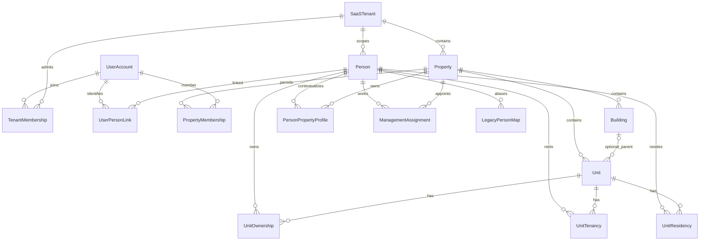

# PERSON REFACTOR — FAZ 02: hedef veri modeli ve sözleşmeler

16.10.2026 — toplam11faz. Durum: **tasarım teslimi; kullanıcı kabulü bekleniyor**. Kaynaklar: `BuildingFlow-Person-Refactor-Prompt-Paketi/{MASTER_PROMPT,STANDARDS,PHASES,AGENTS}.md`, `phases/PHASE-02.md`, [FAZ01 analizi](phase-01-report.md), mevcut core/API/migration sözleşmeleri. Kod, DB, migration veya bağımlılık değişikliği yapılmadı. Bu dosya **uygulanmış API/şema belgesi değildir**; aşağıdaki v2 uçlar, alanlar, hata kodları ve tablolar tasarım önerisidir.

FAZ01 görevi [#6](https://github.com/AkaBayraK/BuildingFlow/issues/6): yapılanlar ve statik kanıtlar doğrulandı; kullanıcı koşullu geçiş onayına dayanarak Done. Uygulama testlerinin FAZ01'de çalıştırılmadığı kayıtta korunur. Aktif FAZ02 görevi [#7](https://github.com/AkaBayraK/BuildingFlow/issues/7); yeni görev açılmaz. FAZ03 otomatik başlamaz.

## 1. Kullanıcının bu fazda kesinleştirdiği erişim tercihi

- Yönetici, **yetkili olduğu tenant içindeki tüm kişileri** görür; yalnız mevcut seçili alanla ilişkili kişilere indirgenmez.
- Ev sahibi/kiracı kişi listesine erişmez; **yalnız kendi kişi kartını salt okunur** görebilir. Başkasının kartını veya ilişkilerini görmez; merkezi Person kaydını düzenleyemez. RESIDENT için de aynı asgari self-read politikası önerilir.
- Ayrı ayrıntılı kişi yetki ekranı/grant sistemi şimdilik eklenmez. Mevcut gerçek yönetici rollerinden yararlanılır: SUPER_ADMIN, SITE_ADMIN, MANAGER. ACCOUNTANT yönetici kabul edilmez ve mevcut kişi veri yasağı korunur.
- Bu tercih tenantlar arası serbest kişi erişimi değildir. Kullanıcının farklı müşteriler arası sınırsız PII erişimi istediği varsayılmadı.
- Kullanıcının kesinleştirdiği konu **okuma kapsamıdır**. Yönetim yazımları yönetici rolü ve sunucu kapsam kontrolü ister; yöneticinin başka bir yönetim alanında ilişki/görev düzenleme yetkisi kişi listesinde görmesiyle genişlemez.

**Açık tasarım varsayımı D01:** bir müşteri/işletme bir SaaSTenant, bir tenant birden çok Property içerir; Person tenant içinde merkezi ve Property'den bağımsızdır. Kullanıcı tenantın gerçek işletme/topoloji sınırını henüz belirlemedi. FAZ03/04 veri yerleştirmesi öncesinde açık tenant→Property eşleme onayı gerekir. Tüm mevcut alanları tek tenant altında otomatik toplamak veya her alanı ayrı tenant saymak onaylanmış değildir.

## 2. Mimari kararlar

| ID | Tasarım kararı | Kabul durumu |
|---|---|---|
| D01 | Tenant müşteri sınırı; Person tenant içinde merkezi | Güvenli taslak; gerçek tenant/alan eşlemesi açık |
| D02 | Yönetici tenanttaki tüm kişiler; sakin/ev sahibi/kiracı self-read, Person write yok | Kullanıcı talimatıyla kesinleşti; tenant sınırı D01'e bağlı |
| D03 | Person üzerinde is_owner/is_tenant/is_manager yok; roller tarihli ilişkilerden hesaplanır | Paket hedefi |
| D04 | Keycloak auth kaynağı; minimal UserAccount identity yalnız issuer+sub, parola kopyası yok | Önerilen hedef, uygulama onayı bekliyor |
| D05 | Bir hesap bir tenantta en fazla bir aktif doğal kişi; bir doğal kişide en fazla bir aktif birincil hesap | Önerilen cardinality; eski çelişkiler otomatik düzeltilmez |
| D06 | Tüzel kişi hesap sahibi doğal kişiyle aynı şey değildir; yeni legal self-link temsil modeli olmadan kapalı | Önerilen güvenlik sınırı; mevcut legacy legal bağları silinmez |
| D07 | Merkezi kimlik alanlarını tenant yönetimi, alan-özel iletişimi ilgili alan yönetimi yazar | Yazım politikası taslak; mevcut realm/üyelik sınırını genişleten uygulama ayrı onay ister |
| D08 | Cross-tenant otomatik dedupe/merge/lookup yok | Varsayılan güvenli hedef |
| D09 | Eski UUID, finans snapshot, mobil fingerprint/makbuz ve tombstone korunur | Zorunlu geriye uyumluluk |
| D10 | Yeni ayrıntılı kişi permission/grant arayüzü yok | Kullanıcı talimatı |

Domain EF/HTTP/UI bağımlılığı almaz; modular monolith korunur. Gerçek adlar Property/Building/Unit kalır; ManagementArea=Property, Block=Building. Yeni servis/depo/bağımlılık önerilmedi. Cross-tenant global Person registry bu fazın hedefi değildir; ileride gerekiyorsa ayrı hukuki/veri sahipliği tasarımı gerekir.

## 3. Hedef ERD

ERD kardinaliteleri tarihçe satırlarının çokluğunu gösterir; **aktif** account↔Person tekilliği D05 ve kısıtlarla sağlanır. Aynı hesabın farklı tenantta ayrı doğrulanmış Person kaydı olabilir; bunlar birbirine ait PII veya ilişkileri açmaz. Tenant dışı global tekil UserAccount yalnız issuer/subject taşır, merkezi kişi bilgisi taşımaz.

## 4. Tablo/alan ve kısıt sözleşmesi

Bütün uygulama tabloları, bağlantı/mapping/audit dahil, mevcut8zorunlu NOT NULL alanı taşır: `id UUID`, `version bigint`, `created_at/by`, `modified_at/by`, `is_deleted`, `is_enabled`. Oluşturma audit'i değişmez, modified audit'i sunucu üretir, version optimistic concurrency'dir; istemci audit gönderemez. Foreign key'ler RESTRICT; hard-delete/cascade yok. Tüm tenant-owned çocuklarda TenantId bulunur ve composite FK doğrular. BaseEntity global query filter'ı yalnız soft-delete sağlar; tenant kontrolünün yerine kullanılmaz.

| Tablo / domain | Alanlar (8ortak alan dışında) | Ana kısıtlar |
|---|---|---|
| SaaSTenant | name, authorization_revision | Kimlik UUID; auth revision sunucuda, monoton; tenant gruplaması manuel onaylı |
| UserAccount | issuer, subject | UNIQUE(issuer,subject); parola/token/refresh/PII kopyası yok; subject normalize edilmez, doğrulanmış issuer kullanılır |
| TenantMembership | tenant_id,user_account_id | UNIQUE aktif tenant+account; aktif üyelik tek başına yönetici rolü vermez |
| Person (canonical `persons`) | tenant_id,kind,citizenship,country_code,identity_number?,first_name,last_name?,birth_date?,gender?,identity_verification_state | AK(tenant_id,id); PropertyId yok. Doğal/tüzel doğrulama mevcut profile kurallarıyla uyumlu; legacy unknown korunur, veri uydurulmaz |
| UserPersonLink | tenant_id,user_account_id,person_id,linked_at,ended_at?,verification_method | Person için composite FK tenant+id; aktif UNIQUE(tenant,account), UNIQUE(tenant,person). Ended bağ immutable, yeniden bağ yeni satır; Person NATURAL şartı servis/transaction'da |
| Property | tenant_id + mevcut alanlar | AK(tenant,id); mevcut UUID/Building/Unit yapısı korunur |
| PropertyMembership | tenant_id,property_id,user_account_id + mevcut subject uyumluluğu | AK/unique aktif tenant+property+account; property scope kontrolünün mevcut kaynağı; yeni role grant sistemi değildir |
| PersonPropertyProfile | tenant_id,property_id,person_id,display_first_name?,display_last_name?,phone?,email?,address? | UNIQUE aktif tenant+property+person; Person/Property compositeFK. Alan-özel PII; diğer alan yönetimine sırf kişi listesi yüzünden açılmaz |
| UnitOwnership | tenant_id,property_id,unit_id,person_id,start_date,end_date?,share_numerator?,share_denominator?,legacy_occupancy_id? | TenantPerson/PropertyUnit compositeFK; pay ikisi null veya ikisi pozitif,numerator≤denominator. Aynı kişi+daire çakışmaz; ortak malik serbest |
| UnitTenancy | tenant_id,property_id,unit_id,person_id,start_date,end_date?,legacy_occupancy_id? | Aynı kişi+daire çakışmaz; farklı kişilerde ortak kiracılık korunur; kira bedeli/kontrat bu fazda eklenmez |
| UnitResidency | tenant_id,property_id,unit_id,person_id,start_date,end_date?,legacy_occupancy_id? | Fiili oturum; sahiplik/kiracılıktan otomatik türetilmez; birden fazla sakin mümkün |
| UnitPrimaryContact | tenant_id,property_id,unit_id,person_id,start_date,end_date?,source_relation_kind,source_relation_id | Mevcut Occupancy primary flag'inin ayrı ilişkiler arasında tekilleşmesi için; aynı dairede tarih çakışan iki primary olamaz; kaynağı aynı scope'ta doğrulanır |
| ManagementAssignment | tenant_id,property_id,person_id,role,start_date,end_date?,ended_reason?,legacy_grant_reference? | SITE_ADMIN/MANAGER/ACCOUNTANT izinli mevcut rol değerleri; ACCOUNTANT kişi listesi erişimi vermez. Aynı kişi+alan+görev çakışmaz; mevcut rol/üyelik üst sınırını aşamaz |
| LegacyPersonMap | tenant_id,property_id,legacy_person_id,canonical_person_id,migration_batch_id | UNIQUE legacyPerson/property; canonical Person ve Property tenantFK; alias başka tenant'a yönlenemez |
| LegacyOccupancyMap | tenant_id,property_id,legacy_occupancy_id,relation_kind,relation_id,migration_batch_id | Tek eski satır tek hedef rolilişkisi; OWNER/TENANT/RESIDENT karıştırılmaz; PrimaryContact mapping ayrıca kayıtlı |
| PersonMergeEvent / MergeMember | tenant_id,operation_id,source_person,target_person,expected_versions,reason,occurred_at + kaynak mapping bilgisi | Aynı tenant,operationUUIDtekil; immutable geçmiş; sözlükte PII yok. Merge iki farklı user hesabını otomatik bağlamaz |

`persons` yeni canonical hedef, mevcut `people` ise expand aşamasında legacy uyumluluk tablosudur. İkisi iki bağımsız iş deposu olarak yazılmaz: cutover öncesi mevcut `people` otoritedir, hedef shadow-only; cutover sonrası canonical otorite ve legacy v1 projection/adapter vardır. Bu fiziksel ayrım **tasarım önerisidir**, henüz yeni entity/tablo oluşturulmadı. Alternatif rename/in-place yaklaşımı FAZ03'te gözden geçirilirse aynı veri/alias kabul ölçütlerini karşılamalı ve raporlanmalıdır. Mevcut Person tipi/EF mapping kırıcı biçimde sessiz değiştirilmez.

PersonPropertyProfile kişiye alan ilişkisi yokken bile kontrollü kayıt/iletişim ihtiyacını karşılar; ownership/tenancy/residency gibi bir rol veya erişim grant'ı sayılmaz. Her yeni tablo gerçekten kullanılan ihtiyaca bağlı uygulanır; merge tabloları merge mutation devreye alınmadan kurulmaz. IdentityNumber raw unique yapılmaz: ülke/kind/normalizasyon/doğrulama ve legacy tekrarlar karara bağlanmadan index eklenmez. Telefon/e-posta unique değildir.

## 5. Tarih, pay ve yaşam döngüsü kuralları

- Tarihler DateOnly ve Europe/Istanbul; iki uç dahil. `end_date >= start_date`. Aynı kişi/Unit/ilişki türünün iki aralığı ortak bir gün taşıyorsa çakışır. Aynı gün biten ilişkiyle yeni aynı tür ilişki aynı gün başlamaz; sonraki gün başlar.
- Diğer kişilerde aynı Unit üzerinde ownership/tenancy/residency mümkündür. Ev sahibi uzaktan malik olabilir; aynı kişi malik+sakin veya başka Unit'te kiracı olabilir. Boolean rol yazılmaz.
- Legacy pay bilinmiyorsa numerator/denominator=null/null kalır. Bilinen aktif paylar **tüm zaman dilimlerinde** toplam≤1; eksik paylar varken “tam100%” iddiası yok. Gelecekteki bir aralıktaki taşma da reddedilir. Para/float ile pay hesaplanmaz; BigInteger/rasyonel doğruluk veya onaylı kesin SQL karşılığı gerekir.
- Kontrol için aynı tenant+Unit parent row lock, snapshot/transaction ve kapsamlı interval denetimi; açık uç partial index tek başına sonlu interval yarışlarını çözmez. Varsayılan çözüm mevcut PostgreSQL transaction/parent row lock ve proje koduyla interval denetimidir; yeni extension kurulmaz. Bütün yazım girişleri aynı kilit sırasını kullanır. FAZ04 gerçek yarış testleriyle bu yaklaşımı doğrular.
- Person ve ilişkilerin pasifleştirme/soft-delete işlemleri geçmişi silmez. Aktif/gelecek ilişki, hesap bağı veya görev varken Person kapanışı açık kuralla reddedilir. Bitiş expectedVersion ve gerekçeli immutable olayla bir kez yazılır; eski bitiş doğrudan değiştirilmez.
- PrimaryContact aynı Unit'te tüm ilişki türleri arasında tarihli tek kişi; tenant dışı relationId kullanılamaz. İlişki bitişi bu kişi artık uygun değilse primary aralığını aynı transaction'da kapatır; başka kişiyi otomatik primary seçmez.
- Mevcut doluluk raporu TENANT/RESIDENT sayar, OWNER'ı saymaz. Yeni read-modelde legacy uyumluluk dönemi aynı semantik; yalnız Residency sayan yeni tanım ayrı ürün kabulü olmadan açılmaz.
- Yönetim görevi kişi başına değil alan+görev+tarih bazlıdır. Görev bitişi daire rolünü silmez; hesabı kişiden çözmek de başka üyelik/görevleri otomatik silmez. Yetki etkisi sunucuda yeniden hesaplanır.

## 6. Erişim matrisi ve veri sahipliği

### Basit mevcut rol politikası

| Aktör | Merkezi kişi listesi/arama | Kişi kartı | Yazım |
|---|---|---|---|
| SUPER_ADMIN | Açıkça seçilmiş tenantın tüm kişileri; mevcut platform istisnası | Seçili tenantta yönetim DTO | Mevcut ayrı yönetim policy'leri ve version; hedef tenant açık |
| SITE_ADMIN / MANAGER | Aktif tenant üyeliği ve geçerli yönetim görevi/geçiş grant'ıyla tenantın **tüm** kişileri | Merkezi ortak kart; diğer alanın özel profil ayrıntıları scope dışında | Merkezi Person yönetimi yönetici policy'sine tabi; alan profili/Unit ilişkisi/görev yazımı yalnız yönettiği Property'de |
| ACCOUNTANT | 403 | Merkezi kart403; ayrıca doğrulanmış kendi doğal kişi self endpoint'i varsa yalnız kendi minimum kartı | Person/ilişki yazımı403; finans yetkisi ayrı |
| OWNER / TENANT / RESIDENT | 403 | Yalnız `/me/person` üzerinden doğrulanmış kendi Person'ı | Tüm merkezi Person/ilişki/account-link/görev yazımları403 |
| Anonim | 401 | 401 | 401 |
| Başka tenant üyesi/yetkisi iptal edilmiş kullanıcı | Yetkisiz tenant404 veya policy seviyesinde403 | Nesne varlığı ifşa edilmeden404 | Reddedilir; UUID bilmek yetki vermez |

Yönetici kişi listesinin Property filtresi isteğe bağlı görüntü filtresidir; bu kullanıcı tercihiyle zorunlu görünürlük sınırı değildir. Buna karşılık tenant filtresi ve aktif rol/üyelik her zaman sunucu zorunluluğudur. Realm rolü tek başına tenant seçimi sağlamaz. TenantId/contextId istemci seçimi yalnız adaydır; her nesne TenantId+Property/Unit bağlamıyla denetlenir. SUPER_ADMIN için bile açık hedef tenant olmadan toplu kişi export/arama ucu eklenmez.

D02 yöneticinin **tüm kartları okumasını** kesinleştirir; merkezi ortak identity yazımı D07 olarak ayrıca kabul edilecek tasarımdır. Diğer Property'nin identity/yerel iletişimini değiştirmek gibi bugünkü kapsamı genişleten uygulama kabul öncesi açılmaz. Ayrı persona permission ekranı veya token'a hayali permission claim'i eklenmez.

### Alan sahipliği

- Person ortak kimliği: kind/ad/kimlik/ülke/doğum/cinsiyet. Doğrulanmış kimliği değiştirirken server audit ve ek doğrulama gerekir; kullanıcı kendisi `verified=true` gönderemez. Legacy identity otomatik VERIFIED olmaz.
- Property profile: o alan için görüntüleme adı/iletişim/adres; alan yönetimi düzenler. V1 UpdatePerson alanı başka tenant/alanın kaydını değiştirmeden bu projection'a uyarlanır. Ortak kimlik değişikliği ayrı v2 işlemdir.
- MobileProfile: mevcut own-account profil/fotoğraf tercihlerinin ayrı kaynağı. Kullanıcı bu profilini düzenlese bile **merkezi Person veya alan profili değişmez**. UI bunların ayrı olduğunu açıklar. Kullanıcının Person değişikliğine izin vermeme kararı bu yolla aşılamaz.
- Keycloak: giriş bilgileri/hesap durumu/parola. Person refactor Keycloak parolasını SQLite/.env/domain tablosuna yazmaz. Password reset veya hesap yönetimi mevcut kullanıcı policy'sinde kalır.
- Finans snapshot,mesaj alıcısı ve tarihçe: oluşturma anının sahibi. Güncel Person merge veya profil değişikliği geçmişi yeniden hesaplamaz.

## 7. Önerilen API v2 sözleşmesi

Mevcut `/api/v1/properties/{propertyId}/people` ve occupancy/notification/finance/mobile uçları **yerinde korunur**; bu tasarım yeni v2 üreticisinin gelecekte uygulanmasına aittir. Tüm çağrılar ortak error/API katmanını kullanır. Version JSON'da pozitif safe integer; UUID empty kabul edilmez. Para string sözleşmesi değişmez; rasyonel pay JSON'da numerator/denominator decimal integer string olarak taşınır.

| Uç | İzin, payload ve dönüş |
|---|---|
| GET `/api/v2/tenants/{tenantId}/people` | Yönetici tenant-wide; page1+,pageSize1–100,search≤200,sortBy=name/createdAt,sortDirection=asc/desc,Property filtresi opsiyonel. Kararlı UUIDtie-break; totalCount tüm filtre kapsamından. Selfroller403 |
| GET `/api/v2/tenants/{tenantId}/people/{personId}` | Yönetici kartı; tenant uyumu. Başka tenant UUID404 |
| POST aynı people kökü | Yönetici policy; operationId+kimlik alanları; version0. İstemciden id/tenant/audit/userlink/roleboolean kabul edilmez; bağlar ayrı komut |
| PUT `.../people/{id}` | Yönetici; operationId,expectedVersion ve değişebilir ortak alanlar. Aktif tenant+writepolicy+audit; legacy alan güncellemesini sessiz tenant-global değişikliğe çevirmemeli |
| GET `/api/v2/tenants/{tenantId}/me/person` | Hesaptan çözülen tenant-local tek Person; body/query personId yok. Bağ yoksa404; aynı hesaba başkaTenantPerson seçilemez. GET yalnız; PUT/PATCH/POSTself mutation yok |
| POST `/api/v2/tenants/{tenantId}/user-person-links` | Mevcut kullanıcı yönetimi SUPER_ADMIN/SITE_ADMIN; operationId,userAccountId,personId,expectedPersonVersion. MANAGER'ın kişileri görebilmesi hesap bağlama yetkisi vermez |
| POST `.../user-person-links/{id}/end` | Aynı yönetim policy;expectedVersion+reason+operationId. Üyelikleri sessiz aç/kapa yapmaz; grant etkisi yeniden hesaplanır |
| GET `/api/v2/tenants/{tenantId}/properties/{propertyId}/unit-relations` | Yönetici scoped liste; kind,unitId,personId,asOf,page. Self kullanıcı yalnız kendi context DTO'sunu alır, bu endpoint'e liste erişimi yok |
| POST `.../properties/{propertyId}/units/{unitId}/ownerships` | Yönetilen alan;operationId,personId,startDate,endDate?,share?;tenant/Property/UnitPersonscope,version ve pay kilidi |
| POST aynı kökte `/tenancies` veya `/residencies` | Aynı scope; ilgili türün tarihi. Bir ilişki oluşturmak ötekini oluşturmaz |
| POST `.../{relationKind}/{relationId}/end` | Yönetilen scope;operationId,expectedVersion,endDate,reason. TENANT bitişinde eski onaylı borç iptal preview sözleşmesi korunur |
| GET/POST `.../properties/{propertyId}/management-assignments` | Yetkili görev yöneticisi; rol sınırı ve Property üyeliği. MANAGER kendine yönetim yetkisi veremez; yalnız mevcutCanManageUsers sınırındaki SUPER/SITE yönetici atayabilir |
| POST `.../management-assignments/{id}/end` | Aynı atama yetkisi;operationId,version,endDate,reason; son yetkiliyi yetim bırakma kontrolü |
| POST `.../people/merge-preview`, POST `.../people/merges` | İlk refactor yayınında kapalı. Yetkili tenant yönetimi+özel kabul sonrası;preview-sourceVersions/digest,operationId,reason. Cross-tenant merge reddi; genel kullanıcı lookup endpoint'i yok |

### DTO ve null sözleşmesi

`PersonSummaryV2`: id,tenantId,displayName,kind,version,isEnabled; yöneticinin tenant-wide listesinde en az gerekli bilgi. İlişki rolleri read-only özet; query ile asOfDate ise sunucu iş günü doğrular. Telefon/e-posta ve kimlik bilgisi listeye zorunlu taşınmaz; yönetici kartında yetkili ortak bilgiler vardır. Diğer Property'nin özel telefon/adresi için o alan kapsamı gerekir.

`PersonDetailV2`: ortak kimlik alanları + verificationState + version;nullablelegacy alanı eksik bilinenden ayırır. `SelfPersonV2`: id,tenantId,displayName,kind ve kullanıcının kendi ortak kayıt bilgileri;canEdit=false,tenant-local ilişki özeti. HMAC/codehash,başka kişilerin UUID/iletişimi,account subject listesi,admin internal note veya merge adayları dönmez. Kendi kimlik numarasının gösterimi dahi tam/maskeli ürün kararına bağlı; default maskeli. `canEdit` UX bilgisidir; yetki backend'dedir.

`RelationV2`: id,tenantId,propertyId,unitId,personId,kind,startDate,endDate?,status(ACTIVE/UPCOMING/ENDED),version;ownership share=null (bilinmiyor) veya `{numerator:"1",denominator:"2"}`. null pay0 değildir. `ManagementAssignmentV2`: aynı alan scope'u+role+dates+version. `PagedV2<T>` mevcut `{items,page,pageSize,totalCount}` biçimini korur;nullable gerekmeyen alanlarda null reddedilir. İstemciden is_owner/is_tenant/is_manager/permission/audit gelirse400 veya açık ignore politikası yerine schema rejection tercih edilir.

### Hata, concurrency ve replay

401 anonim;403 rol/policy yasak;404 izinli scope içinde bulunamadı/nesne gizliliği;400 biçim/tarih/pay/enum hatası;409 staleversion/çakışaninterval/pay/UUIDiçerikfarkı;503 kimlik/storage geçici erişim hatası. Yeni iş kodları yalnız uygulama fazında ErrorCatalog + FEregistry + eşTR/EN/negatif testlerle eklenir. Taslak adlar: BF_PERSON_SCOPE_MISMATCH, BF_PERSON_LINK_CONFLICT, BF_PERSON_MERGE_REVIEW_REQUIRED, BF_OWNERSHIP_SHARE_CONFLICT, BF_RELATION_OVERLAP; **şu anda mevcut kodlar değiller**. Public mesaj tenantlararası kişi varlığını ele vermez.

Bütün yeni mutasyonlarda sunucunun ürettiği aktör + tenant + operationId namespace'inde UUID receipt ve normalize fingerprint kullanılır;scope+commandtype+target+expectedVersions+normalizebody fingerprint'e dahildir. Aynı içerik replay yeni iş oluşturmaz;differentbody409. Retry'da yetki yeniden doğrulanır; revokedaccess makbuza da erişemez. DBbusinesswrite+receipt aynı transaction. Yeni v2 replay **güncel versionlu DTO + appliedOperation** döndürür; eski v1 mobil makbuzun orijinal kayıt/version sonucu değişmez. Alias çözümü eski fingerprint'i yeniden hesaplamaz. FE409'da güncel kaydı açık eylemle yükler; kullanıcı girişi korunur; kör retry yok.

### V1 version ve yazım uyumluluğu için zorunlu geçiş kararı

V2 Person.version ile PersonPropertyProfile.version ayrı entity sürümleridir; eski PersonDTO ise tek version taşır. LegacyPersonMap bu nedenle ek `legacy_view_version` monoton sayacını tutmalıdır: ilk değeri mevcut people.version ile aynıdır. V1 kartında görünür alanı değiştiren her onaylı canonical veya yerel profil yazımı, etkilenen legacy view sayaçlarını aynı transaction içinde artırır. V1 expectedVersion bu sayaçla karşılaştırılır; canonical/profile değişiklikleri de aynı kilit düzeninde yapılır. Böylece eski ekranın değişikliği bilmeden daha yeni kimlik bilgisini ezmesi engellenir. Mapping tablosunun kendi BaseEntity.version alanı bunun yerine kullanılmaz.

V1 UpdatePerson tam profile payload'ı taşır. Adapter ortak identity alanlarını sessizce yok sayamaz veya başka alanın kimliğine yayamaz. Değişmeyen ortak alanlar ve yalnız yerel iletişim/ad güncellemesi mevcut davranışla taşınabilir. Ortak kimlik gerçekten değiştiriliyorsa D07 kapsamında ayrıca kabul edilmiş merkezi yazım akışı gerekir. D07 onaylanmadan eski kimlik düzenlemesini kesen ya da yetkisini genişleten adapter devreye alınmaz; LEGACY modda kalır. Gerekirse yeni v2 ekran ve eski istemci için açık değişiklik/deprecation onayıyla geçilir. Bu bir **çözülmesi gereken davranış uyumluluğu kapısıdır**, tamamlanmış adapter iddiası değildir.

## 8. Merkez ve mobil tüketicilerinin geçişi

| Üretici | Tüketici | Korunacak sözleşme |
|---|---|---|
| Canonical Person ve tenant sorgusu | PeopleWorkspace, PersonPage | Yönetici listesi tenant genelinde; aynı RecordList, ManagementPanel ve TR/EN yaklaşımı |
| V1 alan adapter'ı ve LegacyPersonMap | Eski PersonDTO ve management-contracts | Eski id/propertyId/version/null davranışı; yerel profil güncellemesi başka alanın ortak kimliğini değiştirmez |
| Ortak UserPersonLink servisi | Users API, People API, onboarding | D05 tüm girişlerde aynı kural ve DB kısıtıyla uygulanır; alternatif girişle atlanamaz |
| Daire ilişkileri ve görevler | Session, Owner, Tenant, Manager, Finance, Reports | Aynı tarih ve nesne kapsamı; yönetici kişi listesi izni sakinlere aktarılmaz |
| Mobil session v2 | AuthProvider, context ve cache | tenantId/personId/authorizationRevision sürümlü eklenir; eski session yanıtının biçimi korunur |
| `/me/person` | Mobil ve merkez kendi kartı | Salt okunur; genel kişi listesi indirilmez; ProfileEditor merkezi Person'a yazmaz |
| Sync adapter ve makbuz | Eski outbox ve sync engine | V1 context key, operationId ve fingerprint korunur; yeni namespace'e kopyalayıp tekrar CREATE yapılmaz |

Yeni mobil context key `tenantId:propertyId:unitId:role` olabilir; mevcut v1 `propertyId:unitId:role` anahtarı eski kuyruk için geçerli kalır. Capability/sürüm pazarlığı ve geçiş adapter'ı gereklidir. SQLite schema7 yükseltmesi ayrı FAZ08/09 uygulamasıdır; bekleyen işlemler veya başka hesaba ait izolasyon kaybedilemez. Session whitelist'i yalnız gereken alanları alır; sakin cihazına tenant genelindeki kişi listesi indirilmez.

`authorizationRevision`, yetkiyi etkileyen değişikliklerde tenant kaydında atomik artar. Online dönüşte eski snapshot yenilenir; revizyon tek başına yetki sayılmaz. Sunucu her istekte üyelik, gerçek rol ve geçerli ilişkiyi yeniden denetler. Çevrimdışıyken iptal anında öğrenilemez; bu faz mevcut 24 saatlik üst sınırı artırmaz. PIN/biometri, desteklenmeyen cihaz ve iptal toleransı FAZ08 kabulüne bağlıdır. Ödeme, rol değişimi, kesin tahakkuk ve kişi birleştirme online kalır; yeni ödeme sağlayıcısı eklenmez.

Legacy ve yeni görevlendirme arasında kalıcı `claim OR assignment` bypass bırakılmaz. Geçiş modları LEGACY → SHADOW → ENFORCED olarak tenant bazında, onaylı gruplar ve eski/yeni yetki karşılaştırmasıyla açılır. Person bağı bulunamayan yöneticiye sahte kişi oluşturulmaz; inceleme listesine alınır ve eski erişimin kapatılması ayrıca planlanır. ENFORCED yönetici erişimi gerçek realm rolü üst sınırı, aktif tenant/alan üyeliği ve geçerli görev gerektirir. Sakin erişimi doğrulanmış kişi bağı ve geçerli daire ilişkisine dayanır. Mevcut platform SUPER_ADMIN istisnası korunur; ACCOUNTANT'a kişi listesi açılmaz.

## 9. Merge/dedupe ve veri geçişi

Telefon, e-posta ve isim ortak olabilir; tek başına unique veya merge anahtarı değildir. PersonCode tek kullanımlık bağlama kanıtıdır, kalıcı kişi kimliği değildir. Tenantlar arası merge ilk sürümde desteklenmez; benzer kimlik araması kapsam dışı kayıt varlığını bildiremez. Aynı gerçek kişi farklı tenantlarda ayrı kayıtlarla ve her tenantta ayrı doğrulamayla hesabına bağlanabilir. Global registry veya ortak profil istenirse ayrıca veri sahipliği ve yetkili kabul tasarımı gerekir; bu rapor hukuki uygunluk belgesi değildir.

Tenant içi merge de otomatik değildir. Yetkili inceleme, maskeli preview, bütün kaynak version'ları, ilişki/finans etkisi ve insan onayı gerekir. İki farklı aktif hesap, çakışan tarih/pay/primary veya çelişen doğrulanmış kimlik varsa işlem manual review/409 ile durur. Kaynak ve hedef yetkiler birleştirilerek artırılmaz. Merge kaynak satırı silmez; canonical alias ve değişmez olay kaydı oluşturur. Eski kişi/ilişki UUID'leri ve finans snapshot'ları korunur. Yanlış merge geri alınırken sonradan oluşan ilişkiler kendiliğinden iki kayda bölünmez; ters mapping ve yeni audit olayı gerekir.

Planlanan geçiş sırası:

1. Kullanıcının onayladığı Tenant→Property haritası; PII içermeyen sayım/hash baseline'ı, quiesced yedek ve izole restore provası. Bu faz canlı DB okumadı.
2. İncelenmiş eklemeli migration, Designer ve snapshot. Eski migration dosyaları değişmez; yeni canonical tablolar önce shadow olarak okunur.
3. Her eski Person için başlangıçta ayrı canonical kayıt; otomatik merge yok. Belirsiz tenant, üyelik veya hesap bağı incelemeye ayrılır; genel/default tenant'a toplu atama yapılmaz.
4. OWNER→Ownership (pay bilinmiyor), TENANT→Tenancy, RESIDENT→Residency. Kiracılıktan fiili oturum üretilmez. Primary contact kaynak ilişki kimliğiyle taşınır; sonlu tarih çakışmaları dry-run'da raporlanır.
5. Legacy subject doğrulanmış issuer+subject hesabına eşlenir. Tüzel kişi temsil veya çoklu hesap çelişkileri insan incelemesine kalır; mevcut giriş ve borç kayıtları silinmez.
6. V1 adapter ve shadow read karşılaştırması: liste/detay, context, finans geçmişi, kapsam ve replay eşliği. Her aşamada tek authoritative write yolu bulunur; bağımsız iki Person version sahibi oluşturulmaz.
7. Tenant grubu bazında cutover, yalnız tam mapping kapsamı, sıfır orphan, negatif erişim ve makbuz regresyon kanıtıyla yapılır. Alanın özel profil farklılıkları korunur; eski tahakkuk isimleri yeniden yazılmaz.
8. Contract/drop/rename veya eski istemci desteğinin bitmesi ayrıca açık onay ister. Tasarım onayı veri silme yetkisi değildir.

Rollback: cutover öncesinde eski okumaya dönülebilir. Yeni yazımlar başladıysa quiesce, eski biçimde temsil edilebilirlik ve ters mapping gerekir. Yeni pay/görev/merkezi kişi ilişkisi legacy modelde ifade edilemiyorsa ileri düzeltme veya izole doğrulanmış restore değerlendirilir. Dolu Down ilk drop öncesinde reddeder. Audit, makbuz, alias ve eski mesaj alıcı kapsamı silinmez. Canlı DB'ye reset veya yedek üzerine yazma otomatik yapılmaz.

## 10. Tasarım doğrulaması ve sonraki uygulama kabulü

Bu fazın doğrulaması kaynak koruması ve kontrat tutarlılığıdır. Aşağıdaki satırlar **üretim kodunda geçmiş testler değil, uygulama kabul senaryolarıdır**:

| ID | Senaryo | Beklenen |
|---|---|---|
| C01 | T1 yöneticisi P1 alanını yönetiyor; kişi T1/P2'de | Tenant kişi listesinde görünür; P2 ilişkisi yazım yetkisi otomatik oluşmaz |
| C02 | Aynı yönetici T2 kişisini UUID ile ister | 404; başka tenantın varlığı/iletişimi açılmaz |
| C03 | OWNER/TENANT genel kişi listesi ister | 403 |
| C04 | OWNER kendi bağlı kişi kartını `/me/person` ile ister | 200, canEdit=false |
| C05 | OWNER/TENANT kendi Person kaydına PUT veya ilişki POST yapar | 403 |
| C06 | Anonim liste/kart/yazım ister | 401 |
| C07 | ACCOUNTANT merkezi kişi listesi ister | 403 |
| C08 | Self endpoint'e başka PersonId gönderilir | Reddedilir; kendi kişi bağı sunucudan çözülür |
| C09 | Aynı kişi A'da malik+sakin, B'de çoklu malik, C'de kiracı | Tek merkezi kişi; ayrı tarihli ilişkiler; rol boolean'ı yok |
| C10 | Eski malikin payı bilinmiyor | null/null; eşit pay uydurulmaz |
| C11 | Bilinen paylar1/2+1/2; aynı aralıkta ek1/10 istenir | İlk toplam1; ek pay reddedilir |
| C12 | Aynı kişi/tür için1–10 ve10–20 tarihleri | Gün10 çakışır;409.11–20 başlangıcı kabul edilebilir |
| C13 | Aynı Unit için farklı ilişki türlerinde aynı gün iki primary | 409; ortak primary kuralı korunur |
| C14 | Aynı hesap/tenant iki kişiye People API veya onboarding'den bağlanır | Ortak servis ve DB kısıtı409 |
| C15 | İki farklı aktif hesaplı kişiler birleştirilir | 409/manual review; hesaplar otomatik birleşmez |
| C16 | Başka tenantta aynı ad/telefon/kimlik bulunur | Otomatik merge veya varlık ifşası yok |
| C17 | Aynı operation UUID ve normalize payload tekrarlanır | Tek iş kaydı+makbuz; farklı içerik409 |
| C18 | Kişi merge sonrası eski mobil makbuz tekrar gönderilir | Orijinal makbuz/fingerprint/version korunur; yeni pull doğru alias'ı döndürür |
| C19 | Offline cache varken görev iptal edilir | Online yazım403; reconcile purge; offline TTL sınırı açık gösterilir |
| C20 | V1 profile güncellemesi yapılır | Alan-özel profile uygulanır; başka alanın ortak kimliği değişmez |
| C21 | Kullanıcı MobileProfile düzenler | Merkezi Person alanları değişmez |
| C22 | Merge sonrası eski tahakkuk ve mesaj okunur | Snapshot/alıcı/id/version/audit korunur |
| C23 | Eski expectedVersion gönderilir | 409; FE güncel kaydı açık eylemle yükler, form değerlerini korur |
| C24 | Backfill tekrarı veya yarıda kesinti | Aynı mapping/UUID; duplicate ve orphan yok |

Gerçek domain/API/PG/FE/mobil testleri sonraki uygulama fazlarında bu senaryolara bağlanır. Geçici PostgreSQL, fixture SeaweedFS ve native cihaz kabulü korunur; gerçek kişi/rol üzerinde mutasyon testi yapılmaz. Bu faz dotnet/npm/Expo build/test/restore/install, EF model check, migration veya Fortify/SAST/SCA/secret/lisans taraması çalıştırmadı. Kod veya paket değişmediği için uygulama testi başarısı iddia edilmez. Yeni bağımlılık veya DB eklentisi yok; mevcut PostgreSQL üzerinde kilit/kısıt yaklaşımının gerçek doğrulaması FAZ04'e aittir.

### Yeni lisans yükü olmadan uygulama planı

Çalışma sırasında kök AGENTS.md dosyasına 16.10.2026 kullanıcı kararı olarak eklenen yeni üçüncü taraf bağımlılık yasağı okundu ve korundu. Bu tasarım hiçbir yeni paket, DB eklentisi, font, ikon veya görsel gerektirmez. Mevcut lisans/NOTICE yükümlülükleri ortadan kalkmış sayılmaz.

| İhtiyaç | Yeni bağımlılık eklemeyen varsayılan |
|---|---|
| Tenant scope ve yetki | Mevcut ASP.NET Core policy, mevcut EF/Npgsql ve projeye ait Application servisi |
| Tarih çakışması ve pay toplamı | Parent row lock, mevcut PostgreSQL sorguları, .NET DateOnly ve BCL BigInteger/rasyonel hesap; yeni temporal/interval paketi veya extension yok |
| Dedupe/merge adayları | Projeye ait deterministik normalizasyon ve yetkili manuel inceleme; fuzzy-match/ML paketi yok |
| Sözleşme/DTO doğrulaması | Mevcut .NET doğrulama ve frontend runtime decoder'ları; yeni Zod/RHF/validator paketi yok |
| Yerel kilit ve şifreleme | Zaten kurulu SecureStore/şifreli cache yetenekleri önce sürüm ve cihaz bazında doğrulanır. Ayrı biyometri/PIN paketi kurulmaz; mevcut kabiliyet yetmezse native çözümün kapsamı ayrıca karara bağlanır. Doğaçlama PIN kriptografisi yazılmaz |
| Arayüz/ERD | Mevcut shadcn/TanStack/Lucide/next-intl; raporda Mermaid; yeni tasarım paketi yok |

Dış paket olmadan bir hedef karşılanamıyorsa gerekçe ve mevcut platform alternatifleri kullanıcıya sunulur; bu tasarım onaysız kurulum yetkisi vermez.

## 11. Açık kararlar ve FAZ03 kapısı

1. D01 gerçek tenant/Property haritası; bu karar olmadan tenant verisi yerleştirme veya backfill yok.
2. D05 hesap–kişi cardinality, legacy tüzel temsil ve çelişkili bağların inceleme sahibi.
3. D07 merkezi kimlik yazım aktörü ve eski UI'nin yerel profil davranışı. Kesinleşen yönetici okumasından ayrı kabul edilir.
4. Görev türleri ve atama yetkisinin mevcut SITE_ADMIN sınırı; son yöneticinin görevinin bitirilmesindeki güvence.
5. V2 ve legacy istemci destek süresi; online iptal gecikmesi,24h offline toleransı ve FAZ08 yerel kilit tercihi.

Bu faz gözden geçirilebilir tasarım teslimidir. D02 dışındaki öneriler ürün/mimari kabul öncesi uygulanmaz. FAZ03 için bu raporun kullanıcı onayı gerekir. Tenant ve kimlik kararları açık kalırsa kapsam yalnız ayrıca onaylı, izole ve feature kapalı bir genişletmeyle sınırlanmalı; otomatik canlı şema geçişi yapılmamalıdır. Bu sınır paketin FAZ02 tasarım / FAZ03 uygulama ayrımıdır.

## 12. Teslim, takip ve kanıt

Yalnız bu yeni rapor yazıldı. FAZ01 raporu ve önceki kaynaklar hash kontrolüyle korundu; başlangıçta875dosyanın envanteri alındı. Dal main; commit/push/merge/reset/stash, servis restart veya DB erişimi yok. Ortak progress/roadmap dosyaları değiştirilmedi; faz takibi mevcut #6/#7 görevleri ve raporlarla sağlanır.

FAZ02 adımları:1) kapsam ve önceki kabul,2) model ve scope,3) ilişki kısıtları,4) API ve tüketiciler,5) geçiş/test/risk,6) rapor ve görev teslimi. Final kontrol sonuçları aşağıdaki teslim notunda kaydedilir. FAZ03 başlatılmadı. Ayrıntılı kişi yetki sistemi eklenmedi; D02 kullanıcı kararı tasarıma işlendi.

Yerel yönergeler: `.claude/skills/akadev-phase/SKILL.md`, `.claude/skills/akadev-contract/SKILL.md`. Tek agent; alt agent yok. Giriş/çıkış/toplam token ve kalan context: BİLGİ MEVCUT DEĞİL. Hesap kota penceresi bu fazın token tüketimi değildir.

### Son kontrol —16.10.2026

İlk hash kontrolü AGENTS.md üzerinde bu çalışma dışında yapılmış yeni lisans kuralı değişikliğini saptadı. Fark okunup tasarıma uygulandı; dosya geri alınmadı/değiştirilmedi. Diğer874 başlangıç dosyası, FAZ01 raporu dahil, aynıdır. Bu tur ajanın yazdığı tek kalıcı yerel dosya phase-02-report.md'dir. Uygulama kodu, DB, migration, paket ve kilit dosyaları değişmedi. Bu istisna gizlenerek “875dosya aynı” sonucu verilmedi.

Ayrıca eşzamanlı başka çalışmanın yeni `docs/analysis/PHASE_16_CONSENT_KVKK.md` raporu Git durumunda görüldü; bu tur oluşturulmadı, içeriğine müdahale edilmedi. Son Git farkı bu dış belge ve AGENTS.md değişikliği ile istenen Person tasarım raporu ayrılarak kontrol edildi.

Sonuç:24kabul senaryosunun kimlik/tekillik kontrolü, model/API/tenant/self-read/legacy-version/rollback/bağımlılıksız alternatif başlıkları ve rapor biçimi geçti. Pay/tarih kuralının4küçük matematiksel örneği doğrulandı; bunlar BuildingFlow uygulama testi değildir.874başlangıç dosyası değişmedi; dış AGENTS.md farkı açıkça raporlandı. Uygulama build/test/migration ve güvenlik/lisans taramaları ÇALIŞTIRILMADI.

FAZ02 tasarım adımları6/6=%100,00 teslim edildi; kullanıcı kabulü beklenir. Kabul edilmiş önceki faz1/11=%9,09; uygulama yol haritası sayaçları değiştirilmez. FAZ03 başlamadı. Son durum GitHub#7Inreview;#6Done. Son görev kaydı aynı task içinde maddeler, riskler ve gerçek doğrulama ayrımıyla tutulur.
